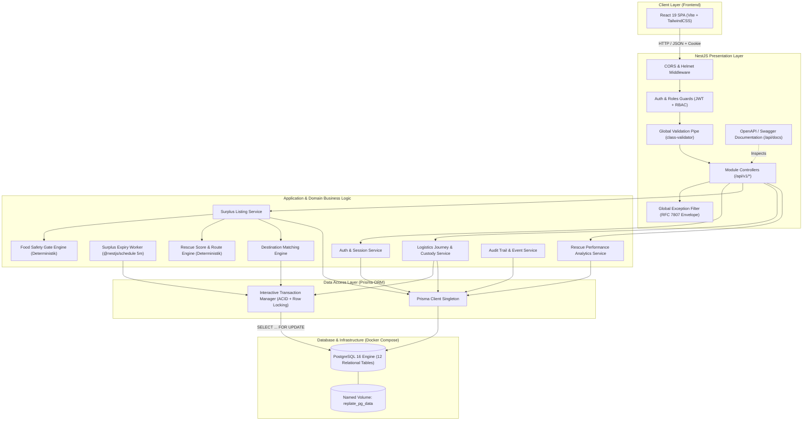
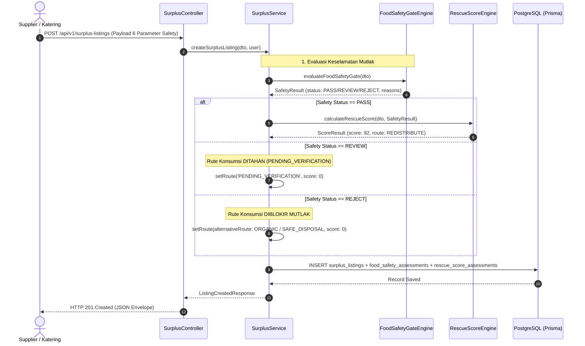
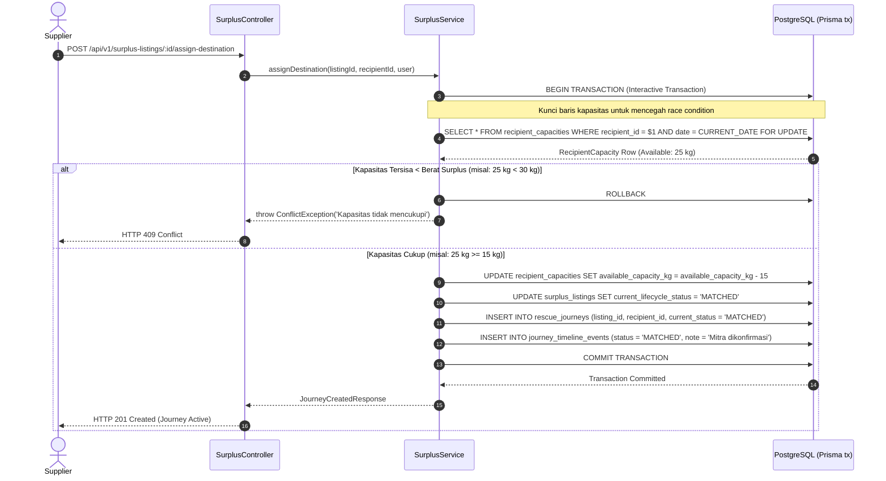
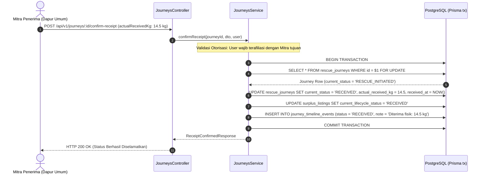
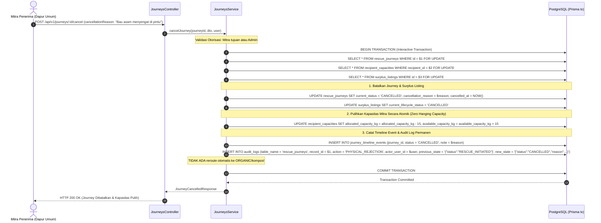

# REPLATE Backend — System Architecture & NestJS Engineering Design

Dokumen ini mendefinisikan arsitektur teknis menyeluruh untuk backend **REPLATE**, mencakup struktur modul NestJS, pola perancangan berlapis (*layered architecture*), diagram alur kerja (*sequence diagrams*), penanganan *cross-cutting concerns*, konfigurasi lingkungan lokal di **Fedora Linux**, serta tata kelola kontainer **Docker Compose**.

---

## 1. Prinsip dan Tujuan Rekayasa Perangkat Lunak

Mengacu pada instruksi `AGENTS.md` dan standar `senior-backend-dev` / `backend-dev-guidelines`:
1. **Keterbacaan dan Kemudahan Pemeliharaan di Atas Segalanya:** Hindari abstraksi yang terlalu rumit atau prematur (*overengineering*). Struktur folder dan kode harus langsung mencerminkan proses bisnis REPLATE.
2. **Arsitektur Berlapis Tanpa Kebocoran Tanggung Jawab:**
   $$\text{Client} \longrightarrow \text{Controller} \longrightarrow \text{Service} \longrightarrow \text{Prisma ORM} \longrightarrow \text{PostgreSQL}$$
   - *Controllers:* Hanya memvalidasi input HTTP, memanggil Service, dan memformat respons. Nol logika bisnis.
   - *Services:* Menampung aturan bisnis domain dan koordinasi data. Bebas dari objek `Request` atau `Response` Express.
   - *Deterministic Engines:* Mesin penilai keselamatan pangan (*Food Safety Gate*) dan kalkulator *Rescue Score* dirancang murni (*pure functions*), deterministik, tanpa efek samping (*side-effects*), dan memiliki cakupan pengujian unit 100%.
   - *Data Layer:* Prisma Client menangani kueri berparameter dan transaksi ACID.
3. **Fail Fast, Fail Loudly:** Validasi seluruh masukan di batas luar API menggunakan DTO (*Data Transfer Objects*) dan class-validator. Input tidak valid langsung ditolak dengan kode status `400 Bad Request` dan pesan yang jelas.
4. **Keamanan Pangan sebagai Gerbang Mutlak (*Hard Gate*):** Logika penentuan rute konsumsi pangan manusia tidak dapat diakses jika Food Safety Gate menghasilkan status `REVIEW` atau `REJECT`.

---

## 2. Diagram Arsitektur Sistem



---

## 3. Struktur Direktori Proyek NestJS (Canonical Directory Layout)

Berikut adalah struktur direktori yang direncanakan untuk implementasi di `backend/`:

```text
backend/
├── docker-compose.yml          # Konfigurasi container PostgreSQL 16
├── .env.example                # Template variabel lingkungan aman
├── package.json                # Dependensi NestJS, Prisma, dll.
├── tsconfig.json               # Konfigurasi TypeScript compiler
├── prisma/
│   ├── schema.prisma           # Skema deklaratif PostgreSQL (12 Entitas)
│   ├── migrations/             # Berkas SQL migrasi terversi
│   └── seed.ts                 # Script seeding data rujukan & akun demo
├── src/
│   ├── main.ts                 # Entry point aplikasi NestJS
│   ├── app.module.ts           # Root module yang menggabungkan seluruh fitur (termasuk ScheduleModule)
│   ├── config/                 # Konfigurasi terpusat & validasi env
│   │   ├── configuration.ts
│   │   └── env.validation.ts
│   ├── common/                 # Primitif lintas modul (cross-cutting)
│   │   ├── decorators/         # @CurrentUser(), @Roles(), @Public()
│   │   ├── filters/            # HttpExceptionFilter (RFC 7807)
│   │   ├── guards/             # JwtAuthGuard, RolesGuard, OwnershipGuard
│   │   ├── interceptors/       # TransformResponseInterceptor, LoggingInterceptor
│   │   ├── pipes/              # ParseUUIDPipe, SanitizePipe
│   │   └── constants/          # Role enum, Lifecycle status enum
│   ├── prisma/                 # Modul koneksi database
│   │   ├── prisma.module.ts
│   │   └── prisma.service.ts
│   ├── modules/
│   │   ├── auth/               # Modul otentikasi & manajemen token
│   │   │   ├── auth.controller.ts
│   │   │   ├── auth.service.ts
│   │   │   ├── auth.module.ts
│   │   │   ├── strategies/     # JwtStrategy, LocalStrategy
│   │   │   └── dto/            # LoginDto, RefreshDto
│   │   ├── surplus/            # Modul pelaporan surplus makanan
│   │   │   ├── surplus.controller.ts
│   │   │   ├── surplus.service.ts
│   │   │   ├── surplus-expiry.worker.ts  # Worker berkala @nestjs/schedule (5 menit)
│   │   │   ├── surplus.module.ts
│   │   │   └── dto/            # CreateSurplusDto, UpdateSafetyDto
│   │   ├── engines/            # Mesin logika deterministik domain REPLATE
│   │   │   ├── food-safety-gate.engine.ts    # Evaluasi PASS/REVIEW/REJECT
│   │   │   ├── rescue-score.engine.ts        # Kalkulasi skor 0-100
│   │   │   ├── route-hierarchy.engine.ts     # Penentuan rute hierarki pangan
│   │   │   └── matching.engine.ts            # Pencocokan kapasitas & jarak mitra
│   │   ├── recipients/         # Modul profil mitra & kapasitas tampung
│   │   │   ├── recipients.controller.ts
│   │   │   ├── recipients.service.ts
│   │   │   ├── capacity.service.ts           # Logika locking kapasitas harian
│   │   │   └── recipients.module.ts
│   │   ├── journeys/           # Modul alur pelacakan logistik & konfirmasi
│   │   │   ├── journeys.controller.ts
│   │   │   ├── journeys.service.ts
│   │   │   ├── journeys.module.ts
│   │   │   └── dto/            # AdvanceStatusDto, ConfirmReceiptDto, CancelDto
│   │   ├── audit/              # Modul pencatatan audit log & timeline
│   │   │   ├── audit.service.ts
│   │   │   └── audit.module.ts
│   │   ├── analytics/          # Modul Rescue Performance & Insights
│   │   │   ├── analytics.controller.ts
│   │   │   ├── analytics.service.ts
│   │   │   └── analytics.module.ts
│   │   └── admin/              # Modul kendali kota & simulasi demo
│   │       ├── admin.controller.ts
│   │       ├── simulation.service.ts
│   │       └── admin.module.ts
│   └── test/                   # Pengujian e2e & integrasi
│       ├── app.e2e-spec.ts
│       ├── food-safety.e2e-spec.ts
│       └── journey-concurrency.e2e-spec.ts
```

---

## 4. Diagram Alur Transaksi Bisnis Utama (Sequence Diagrams)

### 4.1. Pelaporan Surplus & Evaluasi Food Safety Gate



---

### 4.2. Pencocokan Mitra & Alokasi Kapasitas Terkunci (Pessimistic Concurrency)



---

### 4.3. Konfirmasi Serah Terima Fisik di Tujuan (`RECEIVED`)



---

### 4.4. Penolakan Fisik di Lokasi Mitra (Doorstep Physical Rejection $\to$ `CANCELLED`)



---

## 5. Penanganan Cross-Cutting Concerns

### 5.1. Global Validation Pipe
NestJS dikonfigurasi dengan pipa validasi global pada `main.ts`:
```typescript
app.useGlobalPipes(
  new ValidationPipe({
    whitelist: true,              // Hapus otomatis field yang tidak didefinisikan di DTO
    forbidNonWhitelisted: true,  // Tolak request jika mengirimkan field tak dikenal
    transform: true,              // Transformasi payload ke instance class DTO
    transformOptions: {
      enableImplicitConversion: true,
    },
  }),
);
```

### 5.2. Global Exception Filter (RFC 7807)
Semua kesalahan runtime dan HTTP ditangkap oleh `HttpExceptionFilter` terpusat untuk menjamin tidak ada *stack trace* database atau informasi rahasia yang bocor ke klien publik:
- `HttpException` (misal `BadRequestException`, `NotFoundException`, `ForbiddenException`): Dikembalikan dengan kode status yang sesuai beserta rincian validasi field.
- `PrismaClientKnownRequestError` (misal kode `P2002` untuk *unique constraint violation*, `P2003` untuk *foreign key constraint*): Diterjemahkan secara elegan menjadi `409 Conflict` atau `400 Bad Request`.
- *Unhandled Error / Internal Exception:* Dicatat ke log server dan Sentry, lalu mengembalikan `500 Internal Server Error` dengan pesan ramah pengguna.

### 5.3. Konfigurasi CORS
Untuk mendukung komunikasi dengan frontend Vite:
```typescript
app.enableCors({
  origin: process.env.FRONTEND_URL || 'http://localhost:5173',
  credentials: true, // Wajib true agar cookie refreshToken dapat dikirimkan
  methods: ['GET', 'POST', 'PUT', 'PATCH', 'DELETE', 'OPTIONS'],
  allowedHeaders: ['Content-Type', 'Authorization', 'Accept'],
});
```

### 5.4. Dokumentasi OpenAPI (Swagger)
Diintegrasikan melalui `@nestjs/swagger` pada rute `/api/docs`:
- Mendukung otorisasi Bearer JWT langsung di UI Swagger.
- Menampilkan skema DTO, enum nilai, dan contoh respons JSON untuk seluruh modul.

---

## 6. Docker & Local Development Setup (Fedora Linux VM)

### 6.1. Strategi Pengembangan Lokal
- **DBMS:** PostgreSQL 16 berjalan di dalam container Docker Compose.
- **Backend Application:** Dijalankan secara lokal di Fedora VM host (`npm run start:dev`) dengan hot-reload aktif. Ini memberikan performa kompilasi tercepat dan pengalaman debugging yang lancar.
- **Konektivitas Host ke Database:** Host terhubung ke container PostgreSQL melalui `localhost:5432`.

### 6.2. Rancangan File `docker-compose.yml`
```yaml
version: '3.8'

services:
  replate-postgres:
    image: postgres:16-alpine
    container_name: replate-postgres
    restart: unless-stopped
    environment:
      POSTGRES_USER: ${DB_USER:-replate_dev}
      POSTGRES_PASSWORD: ${DB_PASSWORD:-replate_dev_secret}
      POSTGRES_DB: ${DB_NAME:-replate_db}
    ports:
      - "${DB_PORT:-5432}:5432"
    volumes:
      - replate_pg_data:/var/lib/postgresql/data
    healthcheck:
      test: ["CMD-SHELL", "pg_isready -U ${DB_USER:-replate_dev} -d ${DB_NAME:-replate_db}"]
      interval: 5s
      timeout: 5s
      retries: 5

volumes:
  replate_pg_data:
    name: replate_pg_data
```

> [!CAUTION]
> **Peringatan Penting Mengenai Named Volume (`replate_pg_data`):**
> - Data PostgreSQL disimpan secara persisten di named volume `replate_pg_data`.
> - Menjalankan `docker compose down` hanya akan menghentikan dan menghapus container, **data database Anda tetap aman**.
> - **JANGAN PERNAH** menjalankan `docker compose down -v` kecuali Anda memang berniat menghapus seluruh data database lokal secara permanen!

### 6.3. Rancangan File `.env.example`
```env
# Server Configuration
NODE_ENV=development
PORT=3000
API_PREFIX=/api/v1
FRONTEND_URL=http://localhost:5173

# Database Connection (Prisma)
DB_HOST=localhost
DB_PORT=5432
DB_USER=replate_dev
DB_PASSWORD=replate_dev_secret
DB_NAME=replate_db
DATABASE_URL="postgresql://${DB_USER}:${DB_PASSWORD}@${DB_HOST}:${DB_PORT}/${DB_NAME}?schema=public"

# Authentication Secrets (Generate with `openssl rand -hex 32` for production)
JWT_ACCESS_SECRET="dev-insecure-access-secret-replace-in-production-min-32-chars"
JWT_ACCESS_EXPIRES_IN="15m"
JWT_REFRESH_SECRET="dev-insecure-refresh-secret-replace-in-production-min-32-chars"
JWT_REFRESH_EXPIRES_IN="7d"

# Logging & Monitoring
LOG_LEVEL=debug
SENTRY_DSN=""
```

### 6.4. Panduan Perintah Operasional di Fedora Linux
Perintah yang akan digunakan saat fase implementasi dimulai:

```bash
# 1. Menjalankan service database PostgreSQL di latar belakang
docker compose up -d

# 2. Memeriksa status kesehatan container PostgreSQL
docker compose ps

# 3. Menjalankan migrasi database via Prisma
npx prisma migrate dev --name init_replate_schema

# 4. Menjalankan seed data (master food types & demo accounts)
npx prisma db seed

# 5. Menjalankan backend NestJS dalam mode development (hot-reload)
npm run start:dev

# 6. Menjalankan test suite unit & e2e
npm run test
npm run test:e2e
```
