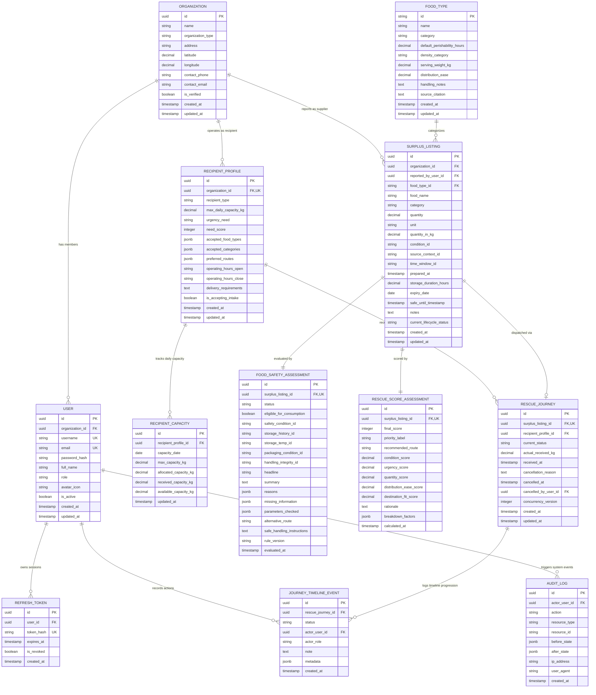

# REPLATE Backend — Data Model & Database Architecture

Dokumen ini mendefinisikan model domain relasional, spesifikasi skema basis data PostgreSQL, relasi kardinalitas, aturan integritas data, indeks performa, serta penanganan transaksi untuk platform **REPLATE**. Seluruh spesifikasi telah diselaraskan dengan keputusan arsitektur final MVP (ADR-001 s/d ADR-012).

---

## 1. Prinsip Perancangan Basis Data

Sesuai dengan `AGENTS.md` Bagian 8 dan pedoman `sql-optimization-patterns`:
1. **Integritas Tingkat Basis Data (*Database-Enforced Integrity*):** Menggunakan *primary key*, *foreign key*, *unique constraint*, dan *check constraint* di mesin PostgreSQL untuk mencegah inkonsistensi data, bukan sekadar validasi aplikasi.
2. **Keterlacakan Audit Permanen (*Auditability*):** Setiap perubahan status alur penyelamatan makanan dan penolakan fisik dicatat di `journey_timeline_events` dan `audit_logs`.
3. **Pencegahan Alokasi Ganda (*Double-Allocation Safety*):** Kuota harian mitra dilindungi transaksi ACID dan *pessimistic row locking* (`SELECT ... FOR UPDATE`).
4. **Pemisahan Siklus Hidup Transaksi:** Memisahkan status pelaporan surplus (`surplus_listings.current_lifecycle_status`) dan status pengiriman fisik (`rescue_journeys.current_status`).
5. **Jumlah Entitas Baku:** Skema PostgreSQL memuat tepat **12 tabel relasional** (mencakup master data katalog pangan terverifikasi dan log audit kepatuhan).

---

## 2. Entity Relationship Diagram (ERD)

---

## 3. Rincian 12 Entitas Basis Data

### 3.1. Entitas `organizations`
Mewakili entitas hukum atau operasional (pemasok katering, restoran, dapur umum penerima, bank makanan, atau fasilitas daur ulang kompos).

| Kolom | Tipe Data | Nullable | Keterangan & Constraints |
|---|---|---|---|
| `id` | `UUID` | No | Primary Key (`gen_random_uuid()`) |
| `name` | `VARCHAR(150)` | No | Nama organisasi (misal: "PT Boga Berkah Katering") |
| `organization_type` | `VARCHAR(50)` | No | Check: `CHECK (organization_type IN ('SUPPLIER', 'RECIPIENT', 'RECOVERY_FACILITY', 'PLATFORM_OPERATOR'))` |
| `address` | `TEXT` | No | Alamat fisik lengkap |
| `latitude` | `NUMERIC(9, 6)` | Yes | Koordinat lintang geospasial |
| `longitude` | `NUMERIC(9, 6)` | Yes | Koordinat bujur geospasial |
| `contact_phone` | `VARCHAR(50)` | Yes | Nomor telepon kontak resmi narahubung |
| `contact_email` | `VARCHAR(255)` | Yes | Email kontak resmi narahubung |
| `is_verified` | `BOOLEAN` | No | Default: `true` |
| `created_at` | `TIMESTAMPTZ` | No | Default: `NOW()` (UTC) |
| `updated_at` | `TIMESTAMPTZ` | No | Default: `NOW()` (UTC) |

---

### 3.2. Entitas `users`
Mewakili akun pengguna berotentikasi. Dibatasi pada 3 role MVP (`ADMIN`, `SUPPLIER`, `MITRA`).

| Kolom | Tipe Data | Nullable | Keterangan & Constraints |
|---|---|---|---|
| `id` | `UUID` | No | Primary Key (`gen_random_uuid()`) |
| `organization_id` | `UUID` | No | FK ke `organizations(id)` ON DELETE RESTRICT |
| `username` | `VARCHAR(50)` | No | Unique (`uq_users_username`), lowercase |
| `email` | `VARCHAR(100)` | No | Unique (`uq_users_email`), lowercase |
| `password_hash` | `VARCHAR(255)` | No | Hash Argon2id / bcrypt |
| `full_name` | `VARCHAR(100)` | No | Nama lengkap pengguna |
| `role` | `VARCHAR(20)` | No | Check: `CHECK (role IN ('ADMIN', 'SUPPLIER', 'MITRA'))` |
| `avatar_icon` | `VARCHAR(20)` | Yes | Simbol emoji avatar ("👑", "🏪", "🤝") |
| `is_active` | `BOOLEAN` | No | Default: `true` |
| `created_at` | `TIMESTAMPTZ` | No | Default: `NOW()` (UTC) |
| `updated_at` | `TIMESTAMPTZ` | No | Default: `NOW()` (UTC) |

---

### 3.3. Entitas `refresh_tokens`
Menyimpan hash refresh token untuk rotasi sesi dan pembatalan (*revocation*).

| Kolom | Tipe Data | Nullable | Keterangan & Constraints |
|---|---|---|---|
| `id` | `UUID` | No | Primary Key (`gen_random_uuid()`) |
| `user_id` | `UUID` | No | FK ke `users(id)` ON DELETE CASCADE |
| `token_hash` | `VARCHAR(64)` | No | Unique (`uq_refresh_tokens_hash`), hash SHA-256 |
| `expires_at` | `TIMESTAMPTZ` | No | Batas kedaluwarsa token (7 hari) |
| `is_revoked` | `BOOLEAN` | No | Default: `false` |
| `created_at` | `TIMESTAMPTZ` | No | Default: `NOW()` (UTC) |

---

### 3.4. Entitas `food_types` (Master Data Katalog Pangan)
Menyimpan data rujukan jenis makanan berstandar FAO/WHO/BPOM. Menjamin integritas relasional pelaporan surplus.

| Kolom | Tipe Data | Nullable | Keterangan & Constraints |
|---|---|---|---|
| `id` | `VARCHAR(50)` | No | Primary Key (misal: `cooked-rice`, `prepared-meals`, `bread-pastries`) |
| `name` | `VARCHAR(100)` | No | Nama jenis pangan |
| `category` | `VARCHAR(50)` | No | Check: `CHECK (category IN ('prepared', 'bakery', 'produce', 'packaged', 'dairy', 'meat_fish', 'other'))` |
| `default_perishability_hours`| `NUMERIC(6, 2)`| No | Ambang batas jam aman basi standar (misal: 4 jam untuk nasi matang) |
| `density_category` | `VARCHAR(20)` | No | `high`, `medium`, `low` |
| `serving_weight_kg` | `NUMERIC(6, 3)` | No | Bobot standar porsi (misal: 0.20 kg untuk nasi, 0.35 kg untuk hidangan komplit) |
| `distribution_ease` | `NUMERIC(5, 2)` | No | Skor kemudahan distribusi bawaan (0–100) |
| `handling_notes` | `TEXT` | Yes | Catatan penanganan suhu kritis |
| `source_citation` | `TEXT` | No | Sitasi ilmiah/regulasi (WHO, USDA, BPOM, Kemenkes) |
| `created_at` | `TIMESTAMPTZ` | No | Default: `NOW()` (UTC) |
| `updated_at` | `TIMESTAMPTZ` | No | Default: `NOW()` (UTC) |

---

### 3.5. Entitas `surplus_listings`
Mewakili data pelaporan surplus makanan dari pihak penyedia (donatur/katering).

| Kolom | Tipe Data | Nullable | Keterangan & Constraints |
|---|---|---|---|
| `id` | `UUID` | No | Primary Key (`gen_random_uuid()`) |
| `organization_id` | `UUID` | No | FK ke `organizations(id)` (Supplier) ON DELETE RESTRICT |
| `reported_by_user_id` | `UUID` | No | FK ke `users(id)` ON DELETE RESTRICT |
| `food_type_id` | `VARCHAR(50)` | No | FK ke `food_types(id)` ON DELETE RESTRICT |
| `food_name` | `VARCHAR(150)` | No | Nama deskriptif surplus |
| `category` | `VARCHAR(50)` | No | Kategori pangan |
| `quantity` | `NUMERIC(10, 2)` | No | Check: `CHECK (quantity > 0)` |
| `unit` | `VARCHAR(20)` | No | Check: `CHECK (unit IN ('kg', 'portions'))` |
| `quantity_in_kg` | `NUMERIC(10, 2)` | No | Check: `CHECK (quantity_in_kg > 0)` (dihitung otomatis oleh server) |
| `condition_id` | `VARCHAR(50)` | No | `fresh_excellent`, `suitable`, `near_window` |
| `source_context_id` | `VARCHAR(50)` | No | `Catering`, `Restaurant`, `Retail`, `Event`, `Bakery`, `School`, `Household`, `Other` |
| `time_window_id` | `VARCHAR(30)` | No | `under_1h`, `1_3h`, `3_6h`, `over_6h` |
| `prepared_at` | `TIMESTAMPTZ` | Yes | Waktu penyiapan makanan |
| `storage_duration_hours` | `NUMERIC(6, 2)` | Yes | Check: `CHECK (storage_duration_hours >= 0)` |
| `expiry_date` | `DATE` | Yes | Tanggal kedaluwarsa pabrik (bila ada) |
| `safe_until_timestamp` | `TIMESTAMPTZ` | No | **Batas Waktu Aman Baku (UTC)** untuk evaluasi Expiry Worker |
| `notes` | `TEXT` | Yes | Catatan tambahan |
| `current_lifecycle_status` | `VARCHAR(30)` | No | Default: `REPORTED`. Check: `CHECK (current_lifecycle_status IN ('REPORTED', 'ASSESSED', 'MATCHED', 'RESCUE_INITIATED', 'RECEIVED', 'CANCELLED', 'EXPIRED'))` |
| `created_at` | `TIMESTAMPTZ` | No | Default: `NOW()` (UTC) |
| `updated_at` | `TIMESTAMPTZ` | No | Default: `NOW()` (UTC) |

---

### 3.6. Entitas `food_safety_assessments`
Mewakili hasil evaluasi deterministik **Food Safety Gate**. Berelasi 1:1 dengan `surplus_listings`.

| Kolom | Tipe Data | Nullable | Keterangan & Constraints |
|---|---|---|---|
| `id` | `UUID` | No | Primary Key (`gen_random_uuid()`) |
| `surplus_listing_id` | `UUID` | No | Unique (`uq_fsg_surplus_id`), FK ke `surplus_listings(id)` ON DELETE CASCADE |
| `status` | `VARCHAR(20)` | No | Check: `CHECK (status IN ('PASS', 'REVIEW', 'REJECT'))` |
| `eligible_for_consumption` | `BOOLEAN` | No | True hanya jika status `PASS` |
| `safety_condition_id` | `VARCHAR(50)` | No | `no_visible_damage`, `altered_needs_check`, `clear_spoilage`, `not_checked` |
| `storage_history_id` | `VARCHAR(50)` | No | `known_compliant`, `unknown`, `suspected_non_compliant`, `not_checked` |
| `storage_temp_id` | `VARCHAR(50)` | No | `hot_holding_above_60`, `cold_holding_below_4`, `ambient_room_temp`, `uncontrolled_fluctuating`, `unknown` |
| `packaging_condition_id` | `VARCHAR(50)` | No | `intact_proper`, `opened_verified_clean`, `damaged_leaking_contaminated`, `not_applicable_fresh`, `not_checked` |
| `handling_integrity_id` | `VARCHAR(50)` | No | `hygienic_separated`, `potential_cross_contamination`, `unknown` |
| `headline` | `VARCHAR(255)` | No | Ringkasan judul hasil gate |
| `summary` | `TEXT` | No | Ringkasan naratif transparan |
| `reasons` | `JSONB` | No | Array string alasan penolakan/review |
| `missing_information` | `JSONB` | No | Array string parameter yang belum lengkap |
| `parameters_checked` | `JSONB` | No | Snapshot detail 6 parameter keselamatan |
| `alternative_route` | `VARCHAR(30)` | Yes | `ORGANIC` atau `SAFE_DISPOSAL` jika REJECT |
| `safe_handling_instructions`| `TEXT` | Yes | Instruksi penanganan limbah/kompos aman |
| `rule_version` | `VARCHAR(20)` | No | Versi aturan (misal: "1.0") |
| `evaluated_at` | `TIMESTAMPTZ` | No | Default: `NOW()` (UTC) |

---

### 3.7. Entitas `rescue_score_assessments`
Mewakili hasil perhitungan **Rescue Score (0–100)** dan rute hierarki makanan. Berelasi 1:1 dengan `surplus_listings`.

| Kolom | Tipe Data | Nullable | Keterangan & Constraints |
|---|---|---|---|
| `id` | `UUID` | No | Primary Key (`gen_random_uuid()`) |
| `surplus_listing_id` | `UUID` | No | Unique (`uq_score_surplus_id`), FK ke `surplus_listings(id)` ON DELETE CASCADE |
| `final_score` | `INTEGER` | No | Check: `CHECK (final_score >= 0 AND final_score <= 100)` |
| `priority_label` | `VARCHAR(30)` | No | `HIGH PRIORITY`, `MEDIUM PRIORITY`, `LOW PRIORITY`, `HOLD`, `ORGANIC RECOVERY` |
| `recommended_route` | `VARCHAR(30)` | No | Check: `CHECK (recommended_route IN ('REDISTRIBUTE', 'PROCESS', 'ORGANIC', 'SAFE_DISPOSAL', 'PENDING_VERIFICATION'))` |
| `condition_score` | `NUMERIC(5, 2)` | No | Skor kondisi (0–100) |
| `urgency_score` | `NUMERIC(5, 2)` | No | Skor urgensi waktu (0–100) |
| `quantity_score` | `NUMERIC(5, 2)` | No | Skor kelayakan volume (0–100) |
| `distribution_ease_score` | `NUMERIC(5, 2)` | No | Skor kemudahan distribusi kategori (0–100) |
| `destination_fit_score` | `NUMERIC(5, 2)` | No | Skor kecocokan ketersediaan mitra (0–100) |
| `rationale` | `TEXT` | No | Penjelasan naratif transparan |
| `breakdown_factors` | `JSONB` | No | Kontribusi bobot masing-masing faktor |
| `calculated_at` | `TIMESTAMPTZ` | No | Default: `NOW()` (UTC) |

---

### 3.8. Entitas `recipient_profiles`
Mewakili profil operasional mitra penerima (dapur umum, bank makanan, shelter, pengolah kuliner, atau fasilitas kompos).

| Kolom | Tipe Data | Nullable | Keterangan & Constraints |
|---|---|---|---|
| `id` | `UUID` | No | Primary Key (`gen_random_uuid()`) |
| `organization_id` | `UUID` | No | Unique (`uq_recipient_org`), FK ke `organizations(id)` ON DELETE RESTRICT |
| `recipient_type` | `VARCHAR(50)` | No | `Community Kitchen`, `Food Bank Distribution Center`, `Shelter Meal Program`, `Youth Program Nutrition`, `Upcycling & Processing Lab`, `Industrial Composting & Bio-hub` |
| `max_daily_capacity_kg` | `NUMERIC(10, 2)` | No | Check: `CHECK (max_daily_capacity_kg > 0)` |
| `urgency_need` | `VARCHAR(20)` | No | Check: `CHECK (urgency_need IN ('high', 'medium', 'low'))` |
| `need_score` | `INTEGER` | No | Check: `CHECK (need_score >= 0 AND need_score <= 100)` |
| `accepted_food_types` | `JSONB` | No | Array ID jenis pangan yang diterima |
| `accepted_categories` | `JSONB` | No | Array kategori pangan yang diterima |
| `preferred_routes` | `JSONB` | No | Array rute yang didukung (`REDISTRIBUTE`, `PROCESS`, `ORGANIC`) |
| `operating_hours_open` | `TIME` | No | Jam buka penerimaan |
| `operating_hours_close`| `TIME` | No | Jam tutup penerimaan |
| `delivery_requirements`| `TEXT` | Yes | Persyaratan logistik masuk |
| `is_accepting_intake` | `BOOLEAN` | No | Default: `true` |
| `created_at` | `TIMESTAMPTZ` | No | Default: `NOW()` (UTC) |
| `updated_at` | `TIMESTAMPTZ` | No | Default: `NOW()` (UTC) |

---

### 3.9. Entitas `recipient_capacities`
Mengelola kuota harian mitra penerima secara terproteksi. Menjamin invariant matematika kapasitas:
$$\text{available\_capacity\_kg} = \text{max\_capacity\_kg} - (\text{allocated\_capacity\_kg} + \text{received\_capacity\_kg})$$

| Kolom | Tipe Data | Nullable | Keterangan & Constraints |
|---|---|---|---|
| `id` | `UUID` | No | Primary Key (`gen_random_uuid()`) |
| `recipient_profile_id` | `UUID` | No | FK ke `recipient_profiles(id)` ON DELETE RESTRICT |
| `capacity_date` | `DATE` | No | Tanggal kalender (YYYY-MM-DD) |
| `max_capacity_kg` | `NUMERIC(10, 2)` | No | Check: `CHECK (max_capacity_kg > 0)` |
| `allocated_capacity_kg`| `NUMERIC(10, 2)` | No | Default: `0`. Check: `CHECK (allocated_capacity_kg >= 0)` |
| `received_capacity_kg` | `NUMERIC(10, 2)` | No | Default: `0`. Check: `CHECK (received_capacity_kg >= 0)` |
| `available_capacity_kg`| `NUMERIC(10, 2)` | No | Check: `CHECK (available_capacity_kg >= 0)` |
| `updated_at` | `TIMESTAMPTZ` | No | Default: `NOW()` (UTC) |

> **Constraint Unik:** `UNIQUE (recipient_profile_id, capacity_date)` menjamin tepat 1 catatan kapasitas per mitra per hari.

---

### 3.10. Entitas `rescue_journeys`
Mewakili catatan fisik pengiriman makanan dari donatur ke mitra penerima. Berelasi 1:1 dengan `surplus_listings`.

| Kolom | Tipe Data | Nullable | Keterangan & Constraints |
|---|---|---|---|
| `id` | `UUID` | No | Primary Key (`gen_random_uuid()`) |
| `surplus_listing_id` | `UUID` | No | Unique (`uq_journey_surplus_id`), FK ke `surplus_listings(id)` ON DELETE RESTRICT |
| `recipient_profile_id` | `UUID` | No | FK ke `recipient_profiles(id)` ON DELETE RESTRICT |
| `current_status` | `VARCHAR(30)` | No | Default: `MATCHED`. Check: `CHECK (current_status IN ('MATCHED', 'RESCUE_INITIATED', 'RECEIVED', 'CANCELLED'))` |
| `actual_received_kg` | `NUMERIC(10, 2)` | Yes | Berat fisik aktual yang diverifikasi mitra saat tiba. Check: `CHECK (actual_received_kg > 0)` |
| `received_at` | `TIMESTAMPTZ` | Yes | Waktu resmi konfirmasi serah terima fisik |
| `cancellation_reason` | `TEXT` | Yes | Wajib diisi jika status beralih ke `CANCELLED` (termasuk penolakan fisik di lokasi mitra) |
| `cancelled_at` | `TIMESTAMPTZ` | Yes | Waktu pembatalan / penolakan fisik |
| `cancelled_by_user_id`| `UUID` | Yes | FK ke `users(id)` (Mitra/Supplier/Admin yang membatalkan) |
| `concurrency_version` | `INTEGER` | No | Default: `1` (Optimistic Concurrency Control) |
| `created_at` | `TIMESTAMPTZ` | No | Default: `NOW()` (UTC) |
| `updated_at` | `TIMESTAMPTZ` | No | Default: `NOW()` (UTC) |

---

### 3.11. Entitas `journey_timeline_events`
Buku besar riwayat status logistik yang bersifat *append-only*.

| Kolom | Tipe Data | Nullable | Keterangan & Constraints |
|---|---|---|---|
| `id` | `UUID` | No | Primary Key (`gen_random_uuid()`) |
| `rescue_journey_id` | `UUID` | No | FK ke `rescue_journeys(id)` ON DELETE CASCADE |
| `status` | `VARCHAR(30)` | No | Status pada tahapan peristiwa (`MATCHED`, `RESCUE_INITIATED`, `RECEIVED`, `CANCELLED`, `EXPIRED`) |
| `actor_user_id` | `UUID` | Yes | FK ke `users(id)` ON DELETE SET NULL |
| `actor_role` | `VARCHAR(30)` | Yes | `SUPPLIER`, `MITRA`, `ADMIN`, atau `SYSTEM_WORKER` |
| `note` | `TEXT` | No | Catatan kronologis peristiwa |
| `metadata` | `JSONB` | Yes | Metadata tambahan (misal alasan penolakan, berat aktual, atau detail expiry) |
| `created_at` | `TIMESTAMPTZ` | No | Default: `NOW()` (UTC) |

---

### 3.12. Entitas `audit_logs`
Mencatat seluruh aksi mutasi kritis untuk kepatuhan sistem dan keamanan pangan.

| Kolom | Tipe Data | Nullable | Keterangan & Constraints |
|---|---|---|---|
| `id` | `UUID` | No | Primary Key (`gen_random_uuid()`) |
| `actor_user_id` | `UUID` | Yes | FK ke `users(id)` ON DELETE SET NULL |
| `action` | `VARCHAR(50)` | No | Misal: `CREATE_SURPLUS`, `REASSESS_SAFETY`, `ASSIGN_DESTINATION`, `ADVANCE_STATUS`, `CONFIRM_RECEIPT`, `CANCEL_JOURNEY`, `EXPIRE_LISTING` |
| `resource_type` | `VARCHAR(50)` | No | `SURPLUS_LISTING`, `FOOD_SAFETY_ASSESSMENT`, `RESCUE_JOURNEY`, `RECIPIENT_CAPACITY` |
| `resource_id` | `VARCHAR(64)` | No | ID resource yang dimodifikasi |
| `before_state` | `JSONB` | Yes | Snapshot data sebelum mutasi |
| `after_state` | `JSONB` | Yes | Snapshot data setelah mutasi |
| `ip_address` | `VARCHAR(45)` | Yes | Alamat IP pemohon |
| `user_agent` | `TEXT` | Yes | User agent klien |
| `created_at` | `TIMESTAMPTZ` | No | Default: `NOW()` (UTC) |

---

### 3.13. Entitas `emergency_food_requests` (Ekspansi Permohonan Darurat)
Mencatat kebutuhan makanan mendesak dari posko/dapur mitra penerima (`EmergencyDistribution.jsx`) untuk dialokasikan dengan surplus aktif.

| Kolom | Tipe Data | Nullable | Keterangan & Constraints |
|---|---|---|---|
| `id` | `UUID` | No | Primary Key (`gen_random_uuid()`) |
| `recipient_id` | `UUID` | No | FK ke `recipient_profiles(id)` ON DELETE CASCADE |
| `requester_user_id` | `UUID` | No | FK ke `users(id)` ON DELETE RESTRICT |
| `needed_food_type` | `VARCHAR(100)` | No | Opsi kategori kebutuhan (`cooked_meals`, `fresh_produce`, dll.) |
| `food_type_name` | `VARCHAR(255)` | No | Label display jenis pangan |
| `requested_portions` | `INTEGER` | No | CHECK (`requested_portions > 0`) |
| `estimated_kg` | `DECIMAL(10,2)` | No | Standar konversi `portions * 0.35 kg` |
| `beneficiary_count` | `INTEGER` | No | CHECK (`beneficiary_count > 0`) |
| `beneficiary_group` | `VARCHAR(255)` | No | Misal: 'Pengungsi Banjir & Warga Terdampak' |
| `target_location` | `TEXT` | No | Alamat posko tujuan pengiriman |
| `urgency_level` | `ENUM` | No | `CRITICAL`, `HIGH`, `MEDIUM` |
| `urgency_deadline` | `VARCHAR(255)` | No | Batas waktu pemenuhan (misal: 'Sebelum 12:30 WIB') |
| `urgency_reason` | `TEXT` | No | Alasan urgensi (min 10 karakter) |
| `contact_person` | `VARCHAR(255)` | No | Nama narahubung koordinator posko |
| `contact_phone` | `VARCHAR(50)` | No | Nomor telepon aktif koordinator |
| `notes` | `TEXT` | Yes | Catatan alergi / penanganan khusus |
| `status` | `ENUM` | No | `OPEN`, `ALLOCATED`, `FULFILLED`, `CANCELLED` |
| `matched_surplus_id` | `UUID` | Yes | FK ke `surplus_listings(id)` ON DELETE SET NULL |
| `cancel_reason` | `TEXT` | Yes | Catatan saat dibatalkan |
| `matched_at` | `TIMESTAMPTZ` | Yes | Waktu alokasi surplus donor |
| `fulfilled_at` | `TIMESTAMPTZ` | Yes | Waktu makanan tiba di posko |
| `cancelled_at` | `TIMESTAMPTZ` | Yes | Waktu pembatalan permohonan |
| `is_deleted` | `BOOLEAN` | No | Default `false` (Penanda Tombstone soft-delete) |
| `deleted_at` | `TIMESTAMPTZ` | Yes | Waktu soft delete |
| `created_at` | `TIMESTAMPTZ` | No | Default `NOW()` |
| `updated_at` | `TIMESTAMPTZ` | No | Auto update `NOW()` |

---

### 3.14. Entitas `emergency_broadcasts`
Menyimpan siaran darurat berbatas waktu (*pull model*) yang dipublikasikan secara otomatis saat mitra posko membuat permohonan darurat.

| Kolom | Tipe Data | Nullable | Keterangan & Constraints |
|---|---|---|---|
| `id` | `UUID` | No | Primary Key (`gen_random_uuid()`) |
| `emergency_request_id` | `UUID` | No | Unique, FK ke `emergency_food_requests(id)` ON DELETE CASCADE |
| `recipient_org_name` | `VARCHAR(255)` | No | Nama organisasi posko pemohon |
| `recipient_location` | `VARCHAR(500)` | No | Lokasi tujuan pengantaran |
| `needed_food_type` | `VARCHAR(100)` | No | Kategori pangan yang dibutuhkan |
| `food_type_name` | `VARCHAR(255)` | Yes | Nama spesifikasi makanan |
| `requested_portions` | `INTEGER` | No | Jumlah porsi yang diminta |
| `target_quantity_kg` | `NUMERIC(10, 2)` | No | Estimasi bobot net (0.35 kg/porsi) |
| `urgency_level` | `ENUM` | No | `CRITICAL` (<2h), `HIGH` (2-4h), `MEDIUM` (end of day) |
| `urgency_deadline` | `VARCHAR(255)` | Yes | Label tenggat waktu |
| `urgency_reason` | `TEXT` | No | Alasan kebutuhan mendesak |
| `contact_person` | `VARCHAR(255)` | Yes | Nama narahubung posko |
| `contact_phone` | `VARCHAR(50)` | Yes | Nomor telepon narahubung |
| `radius_km` | `NUMERIC(5, 2)` | No | Radius broadcast default `10.0` km |
| `expires_at` | `TIMESTAMPTZ` | No | Batas waktu kedaluwarsa otomatis siaran |
| `status` | `ENUM` | No | `ACTIVE`, `RESPONDED`, `EXPIRED`, `FULFILLED`, `CANCELLED` |
| `created_at` | `TIMESTAMPTZ` | No | Default `NOW()` |
| `updated_at` | `TIMESTAMPTZ` | No | Auto update `NOW()` |

---

### 3.15. Entitas `supplier_broadcast_responses`
Mencatat konfirmasi bantuan darurat yang diberikan oleh penyedia surplus/katering.

| Kolom | Tipe Data | Nullable | Keterangan & Constraints |
|---|---|---|---|
| `id` | `UUID` | No | Primary Key (`gen_random_uuid()`) |
| `broadcast_id` | `UUID` | No | FK ke `emergency_broadcasts(id)` ON DELETE CASCADE |
| `supplier_org_id` | `UUID` | No | FK ke `organizations(id)` ON DELETE RESTRICT |
| `supplier_org_name` | `VARCHAR(255)` | No | Nama badan katering/restoran donor |
| `supplier_user_id` | `UUID` | No | FK ke `users(id)` ON DELETE RESTRICT |
| `surplus_listing_id` | `UUID` | Yes | FK ke `surplus_listings(id)` (listing donasi darurat otomatis) |
| `journey_id` | `UUID` | Yes | FK ke `rescue_journeys(id)` (perjalanan logistik otomatis) |
| `status` | `ENUM` | No | `CONFIRMED`, `IN_TRANSIT`, `DELIVERED`, `CANCELLED` |
| `responded_at` | `TIMESTAMPTZ` | No | Default `NOW()` |
| `updated_at` | `TIMESTAMPTZ` | No | Auto update `NOW()` |

> **Constraint Unik:** `UNIQUE (broadcast_id, supplier_org_id)` mencegah donor yang sama mengonfirmasi ganda siaran darurat yang sama.

---

## 4. Strategi Indeks Basis Data & Pola Kueri

| Nama Indeks | Tabel | Kolom | Rationale & Kueri Teroptimasi |
|---|---|---|---|
| `idx_surplus_org_status` | `surplus_listings` | `(organization_id, current_lifecycle_status)` | Portal Supplier: mengambil daftar kiriman aktif dan riwayat milik katering sendiri (`GET .../my-dispatches`). |
| `idx_surplus_expiry` | `surplus_listings` | `(current_lifecycle_status, safe_until_timestamp)` | Background Expiry Worker: kueri cepat setiap 5 menit mencari listing yang melewati batas aman tanpa sequential scan. |
| `idx_fsg_status` | `food_safety_assessments` | `(status)` | Filtering kepatuhan audit keamanan pangan (`PASS`, `REVIEW`, `REJECT`). |
| `idx_journey_recipient` | `rescue_journeys` | `(recipient_profile_id, current_status)` | Portal Mitra: mengambil antrean pasokan masuk (*inbound queue*) menuju dapur umum terkait. |
| `idx_journey_status_date`| `rescue_journeys` | `(current_status, created_at DESC)` | Dashboard Admin & Analytics: agregasi 4 KPI rantai pasok dan visualisasi pipeline funnel. |
| `idx_timeline_journey` | `journey_timeline_events`| `(rescue_journey_id, created_at ASC)` | Rekonstruksi garis waktu (*timeline*) secara berurutan dan cepat tanpa sort memori besar. |
| `idx_recipient_capacity` | `recipient_capacities` | `(recipient_profile_id, capacity_date)` | Kueri alokasi kuota harian dengan *pessimistic row locking* (`SELECT ... FOR UPDATE`). |
| `idx_refresh_tokens_hash`| `refresh_tokens` | `(token_hash)` | Verifikasi cepat refresh token saat rotasi sesi autentikasi. |

---

## 5. Matriks Asal Data (Input Klien vs Sistem Komputasi)

| Kolom / Field | Berasal dari Input Klien | Dihitung / Divalidasi oleh Backend | Tidak Boleh Diubah Klien (*Server Immutable*) |
|---|---|---|---|
| `food_name`, `quantity`, `unit` | ✅ Ya | Validasi format DTO & angka positif | ❌ Tidak |
| `quantity_in_kg` | ❌ Tidak | ✅ Dihitung dari benchmark porsi (0.35 kg/porsi) | ✅ Ya |
| `prepared_at` | ✅ Ya | Divalidasi tidak boleh di masa depan (> toleransi 5m) | ❌ Tidak |
| `safe_until_timestamp` | ❌ DILARANG | ✅ Dihitung otomatis: `preparedAt + perishabilityHours` | ✅ Ya |
| `food_safety_assessments.status` | ❌ DILARANG KERAS | ✅ Dihasilkan secara deterministik oleh Food Safety Gate | ✅ Ya |
| `rescue_score_assessments.final_score` | ❌ DILARANG KERAS | ✅ Dihitung oleh Rescue Score Engine (0 jika REJECT) | ✅ Ya |
| `recommended_route` | ❌ DILARANG KERAS | ✅ Ditentukan oleh Route Hierarchy Engine | ✅ Ya |
| `available_capacity_kg` | ❌ DILARANG KERAS | ✅ Dihitung di dalam transaksi ACID terkunci | ✅ Ya |
| `actual_received_kg` | ✅ Ya (khusus role MITRA) | Diverifikasi positif & dicatat auditnya | ❌ Tidak |
| `cancellation_reason` | ✅ Ya (wajib saat cancel) | Diverifikasi string non-kosong | ❌ Tidak |
| `journey_timeline_events` | ❌ DILARANG KERAS | ✅ Dihasilkan secara otomatis oleh sistem saat transisi | ✅ Ya |
