# REPLATE Backend — Master Implementation Plan & Frontend Audit

> [!NOTE]
> **Status Perencanaan Ekstensi (Fase 9 s/d 12):** `DONE` (Telah Berhasil Dieksekusi & Teruji Penuh)
> **Fase 13 (Sistem SOS Emergency Food Broadcast):** `PLANNED` (Desain final & siap dieksekusi)
> Modul backend untuk Distribusi Darurat (Fase 9), Registrasi Akun Mandiri (Fase 10), Tombstone Deletion (Fase 11), dan Insiden Transit (Fase 12) telah diimplementasikan lengkap dengan 62 unit/integration tests lulus 100%. Saat ini direncanakan perluasan arsitektur SOS Broadcast terkoordinasi (Fase 13) untuk menjembatani permintaan darurat mitra dengan donor katering/restoran terdekat.

Dokumen ini memuat hasil audit menyeluruh terhadap kode sumber frontend **REPLATE**, inventaris fitur, pemetaan kebutuhan backend, analisis risiko teknis, serta *roadmap* implementasi bertahap untuk pengembangan backend NestJS dan PostgreSQL.

---

## 1. Ringkasan Eksekutif & Hasil Audit Frontend

Frontend REPLATE adalah aplikasi SPA (*Single Page Application*) yang dibangun dengan **React 19**, **Vite 8**, dan **TailwindCSS 3**. Saat ini, seluruh data disimpan di penyimpanan peramban lokal (`localStorage`) melalui berkas utilitas `src/utils/storage.js`.

### 1.1. Inventaris Fitur Frontend Lengkap

| Fitur / Halaman | Role Terkait | Data yang Dibutuhkan | Operasi Pengguna | Sumber Data Saat Ini | Kebutuhan Backend |
|---|---|---|---|---|---|
| **Beranda (`Home.jsx`)** | Publik / Tamu | Ringkasan visi, 7 tahapan penyelamatan, statistik cepat | Menjelajahi platform, membuka modal login, navigasi cepat ke form lapor | Statis (`src/data/rules.js`, `foods.js`) | Endpoint data publik: `GET /api/v1/reference/food-types` |
| **Portal Supplier (`SupplierDashboard.jsx`)** | `SUPPLIER` | Kiriman aktif, total porsi terselamatkan, nilai ekonomi CSR, status kepatuhan Food Safety Gate | Melaporkan surplus baru, melihat pengiriman berjalan, membuka rincian logistik | `localStorage` (`replate_surplus_reports_v1`) | `GET /api/v1/surplus-listings/my-dispatches`, agregasi KPI donor |
| **Portal Mitra Penerima (`MitraDashboard.jsx`)** | `MITRA` | Antrean pasokan masuk (*inbound queue*), estimasi waktu tiba, kapasitas tampung harian, total porsi diterima | Memeriksa antrean masuk, menerima pengiriman fisik, membuka rincian alokasi | `localStorage` (`replate_surplus_reports_v1`), `destinations.js` | `GET /api/v1/journeys?filter=INBOUND`, `GET /api/v1/recipients/my-capacity` |
| **Portal Admin (`AdminDashboard.jsx`)** | `ADMIN` | Seluruh data surplus kota, funnel pipeline rantai pasok, bottleneck >2 jam, metrik ekonomi dan lingkungan | Memantau seluruh armada logistik kota, memuat/mereset data simulasi demo | `localStorage`, `calculateRescuePerformance()` di `calculations.js` | `GET /api/v1/analytics/performance`, `POST/DELETE /api/v1/admin/simulation/*` |
| **Lapor Surplus (`ReportSurplus.jsx`)** | `SUPPLIER`, `ADMIN` | Katalog jenis pangan, parameter Food Safety Gate (kondisi, suhu, kemasan, higienitas, waktu simpan) | Mengisi formulir pelaporan surplus, validasi tanggal/jam, memilih preset cepat | `src/data/foods.js`, `TIME_WINDOWS`, `CONDITION_OPTIONS` | `POST /api/v1/surplus-listings` dengan validasi server ketat |
| **Penilaian & Rute (`Assessment.jsx`)** | `SUPPLIER`, `ADMIN` | Hasil evaluasi Food Safety Gate, skor Rescue Score (0–100), rekomendasi rute hierarki pangan, kandidat mitra cocok | Mengubah parameter keselamatan di tempat (*EditSafetyModal*), memilih mitra penampung, konfirmasi rute kompos | `src/engine/foodSafetyGate.js`, `rescueScore.js`, `routeEngine.js`, `matchingEngine.js` | `GET /api/v1/surplus-listings/:id/assessment`, `POST .../assign-destination` |
| **Pelacakan Perjalanan (`Journey.jsx`)** | `SUPPLIER`, `MITRA`, `ADMIN` | Catatan transaksi surplus, timeline status berurutan, badge Food Safety Gate, profil mitra tujuan | Memfilter daftar perjalanan (ALL/ACTIVE/COMPLETED/CANCELLED), memilih baris timeline | `localStorage` (`replate_surplus_reports_v1`) | `GET /api/v1/journeys`, `GET /api/v1/journeys/:id` |
| **Timeline Logistik (`JourneyTimeline.jsx`)** | `SUPPLIER`, `MITRA`, `ADMIN` | Rincian tahapan perjalanan (REPORTED s/d RECEIVED), catatan kronologis | Menyerahkan ke kurir (`RESCUE_INITIATED`), konfirmasi serah terima fisik (`RECEIVED`), membatalkan pengiriman | `updateJourneyStatus()` di `storage.js` | `PATCH /api/v1/journeys/:id/advance-status`, `POST .../confirm-receipt`, `POST .../cancel` |
| **Kinerja Penyelamatan (`Impact.jsx`)** | Publik, Seluruh Role | 4 KPI rantai pasok kota, pipeline funnel, valuasi surplus value exchange, estimasi CO2e dan air | Melihat metrik operasional terverifikasi, membuka-tutup metodologi lingkungan sekunder | `calculateRescuePerformance()` di `src/utils/calculations.js` | `GET /api/v1/analytics/performance` |
| **Wawasan & Simulator (`Insights.jsx`)** | Seluruh Role | Pola makanan paling sering surplus, sumber asal terbanyak, rute dominan, input simulator biaya bahan | Melihat rekomendasi pencegahan otomatis di hulu, menyimulasikan penghematan belanja | `generateInsights()` di `calculations.js`, `PreventionSimulator.jsx` | `GET /api/v1/analytics/insights` |
| **Pusat Edukasi (`Learn.jsx`)** | Publik | 5 modul edukasi rantai pasok, metodologi Food Safety Gate, daftar rujukan resmi WHO/Kemenkes/BPOM | Membaca modul edukasi, berpindah tab metodologi | Statis (`src/data/learning.js`, `foodSafetyGate.js`) | Tidak memerlukan API dinamis (tetap sebagai konten statis / CMS rujukan) |
| **Modal Login & Role Switcher (`RoleWorkspaceBar.jsx`, `LoginModal.jsx`)** | Seluruh Role | Akun pengguna demo (Admin, Supplier, Mitra) | Login instan 1-klik, login username/password, logout, berpindah portal cepat | `DEMO_USERS` di `src/utils/storage.js` | `POST /api/v1/auth/login`, `POST /api/v1/auth/refresh`, `POST /api/v1/auth/logout` |

---

### 1.2. Temuan Kritis dari Audit Kode Sumber

1. **Struktur Data Terduplikasi & Inkonsistensi Mock Data:**
   - Objek `foodSafetyGate` disimpan secara redundan di dalam objek laporan surplus (`report.foodSafetyGate`), dan saat bersamaan sebagian informasinya diduplikasi ke dalam array `journeyEvents` sebagai string teks biasa.
   - Pada `destinations.js`, atribut kapasitas `currentAvailableCapacityKg` bersifat statis. Saat pengguna memilih mitra di halaman `Assessment`, nilai kapasitas mitra di memori lokal tidak dipotong secara terpusat, sehingga memungkinkan terjadinya *overbooking* jika beberapa pengguna menggunakan aplikasi.
2. **Penyimpanan State Sementara yang Rentan Hilang (*Transient State Gap*):**
   - Pada `ReportSurplus.jsx`, saat formulir disubmit, data hanya disimpan di React state (`pendingReport`) dan belum disimpan ke `localStorage`. Data baru benar-benar disimpan permanen setelah pengguna memilih mitra di halaman `Assessment`. Jika pengguna menutup tab peramban di halaman `Assessment`, draft laporan surplus tersebut hilang sepenuhnya. Backend harus mendukung penyimpanan draft/intake awal.
3. **Pemisahan Tanggung Jawab Logika (*Business Logic Boundaries*):**
   - **Wajib Dipindahkan ke Backend:**
     - Evaluasi **Food Safety Gate** (harus dijalankan di server agar penilai keselamatan tidak dapat di-bypass dengan mengubah JavaScript di peramban).
     - Perhitungan **Rescue Score** dan penentuan **Route Hierarchy** (mencegah manipulasi skor prioritas).
     - **Pencocokan Mitra & Pengurangan Kapasitas** (wajib dilindungi transaksi database dengan penguncian baris `SELECT ... FOR UPDATE`).
     - **Autentikasi & Otorisasi** (menggantikan akun demo teks polos dengan hash Argon2id/bcrypt dan JWT berotentikasi server).
   - **Tetap Tepat Dijalankan di Frontend:**
     - Validasi awal formulir secara *real-time* (umpan balik instan sebelum tombol submit ditekan).
     - Simulator Pencegahan Surplus Interaktif (`PreventionSimulator.jsx`) yang berjalan secara dinamis di sisi klien untuk visualisasi penghematan dapur.
     - Pengalihan bahasa dwibahasa (ID/EN) pada antarmuka pengguna (`i18n.js`).
     - Pemformatan angka mata uang Rupiah dan tanggal lokal (`formatters.js`).
4. **Strategi Adaptasi Frontend Tanpa Mengubah Desain UI:**
   - Dibuat lapisan layanan API (`frontend/src/services/api.js`) yang mengimplementasikan antarmuka yang sama dengan fungsi-fungsi di `src/utils/storage.js` (`getReports`, `saveReport`, `updateJourneyStatus`, `loginUser`).
   - Dengan pendekatan ini, komponen UI frontend (`Assessment.jsx`, `Journey.jsx`, `SupplierDashboard.jsx`, dll.) dapat beralih dari `localStorage` ke API backend secara bertahap tanpa perlu penulisan ulang (*zero UI redesign*).

---

## 2. Matriks Analisis Risiko Teknis & Pengendaliannya

| Risiko Teknis / Bisnis | Dampak | Pengendalian Arsitektur (*Mitigation Control*) | Rencana Pengujian (*Verification Test Case*) |
|---|---|---|---|
| **Bypass Food Safety Gate dari Klien** | 🔴 Kritis (Potensi keracunan pangan publik) | Evaluasi Food Safety Gate dijalankan ulang secara deterministik di server. Server mengabaikan status yang dikirimkan oleh klien. | Unit & Integration Test: Mengirimkan payload request dengan makanan berlendir/kedaluwarsa namun disisipkan `"status": "PASS"`. Server wajib menolak dan mengubah status menjadi `REJECT`. |
| **Rescue Score Mengesampingkan Status REJECT/REVIEW** | 🔴 Kritis (Makanan tidak layak disalurkan ke dapur umum) | Di dalam Route Engine dan Matching Engine, kondisi `status === 'REJECT'` atau `'REVIEW'` memblokir mutlak rute `REDISTRIBUTE` dan `PROCESS`. | Unit Test: Makanan berstatus `REJECT` dengan urgency dan volume maksimal wajib mengembalikan daftar mitra konsumsi kosong (`matches: []`). |
| **Alokasi Ganda (*Double Allocation*) / Race Condition Kapasitas Mitra** | 🔴 Kritis (Kapasitas tampung mitra jebol) | Transaksi PostgreSQL ACID dengan *pessimistic row locking* (`SELECT ... FOR UPDATE`) pada `recipient_capacities`, ditambah *database check constraint* `available_capacity_kg >= 0`. | Concurrency Test: 10 request bersamaan mencoba memesan kapasitas 10 kg pada mitra yang hanya memiliki sisa kuota 15 kg. Hanya 1 request yang boleh berhasil, 9 lainnya wajib menerima `409 Conflict`. |
| **Manipulasi Kepemilikan (*Insecure Direct Object Reference - IDOR*)** | 🔴 Kritis (Supplier A membatalkan donasi Supplier B) | Implementasi `OwnershipGuard` di NestJS: memverifikasi bahwa `surplusListing.organizationId === user.organizationId`. | Integration Test: User Supplier A mencoba mengubah data `surplusListing` milik Supplier B; server wajib mengembalikan `403 Forbidden`. |
| **Transisi Status Logistik Tidak Sah (*Invalid Lifecycle Transition*)** | 🟡 Tinggi (Inkonsistensi data pelacakan) | Mesin status (*State Machine*) di `JourneysService`: hanya mengizinkan transisi maju yang sah (`REPORTED` $\to$ `ASSESSED` $\to$ `ROUTE_SELECTED` $\to$ `MATCHED` $\to$ `RESCUE_INITIATED` $\to$ `RECEIVED`). | Unit Test: Mencoba memajukan status dari `REPORTED` langsung ke `RECEIVED`; server wajib menolak dengan `400 Bad Request`. |
| **Pembagian dengan Nol (*Zero Division*) pada Metrik Kinerja** | 🟡 Menengah (Server error pada saat data kosong) | Penanganan defensif di `AnalyticsService`: jika transaksi jatuh tempo atau selesai berjumlah 0, kembalikan `null` atau `0%` dengan keterangan transparan *"Belum ada data"*. | Unit Test: Menghitung kinerja analitik saat basis data kosong; memastikan output aman tanpa `NaN` atau `500 Server Error`. |
| **SQL Injection & Kebocoran Kredensial** | 🔴 Kritis (Kompromi integritas database) | Prisma ORM dengan *parameterized queries* otomatis. Variabel lingkungan divalidasi via Zod. Rahasia tidak disimpan di repositori. | Security Audit: Kueri pencarian dengan injeksi SQL klasik (`' OR 1=1 --`) diperlakukan murni sebagai literal string pencarian. |

---

## 3. Roadmap Implementasi Bertahap (Phased Roadmap)

Berikut adalah urutan implementasi backend yang dirancang secara bertahap, berlandaskan prinsip *boring technology*, teruji, dan mengutamakan stabilitas:

```mermaid
flowchart LR
    P1["Fase 1: Setup & Fondasi Database (DONE)"] --> P2["Fase 2: Auth & RBAC (DONE)"]
    P2 --> P3["Fase 3: Food Safety & Surplus Intake (DONE)"]
    P3 --> P4["Fase 4: Scoring & Matching Engine (DONE)"]
    P4 --> P5["Fase 5: Journey & Concurrency Lock (DONE)"]
    P5 --> P6["Fase 6: Analytics & Performance KPI (DONE)"]
    P6 --> P7["Fase 7: Integrasi Frontend Bertahap (DONE)"]
    P7 --> P8["Fase 8: Hardening & Testing (DONE)"]
    P8 --> P9["Fase 9: Emergency Requisition (DONE)"]
    P9 --> P10["Fase 10: User Self-Register (DONE)"]
    P10 --> P11["Fase 11: Tombstone Deletion (DONE)"]
    P11 --> P12["Fase 12: In-Transit Incidents (DONE)"]
    P12 --> P13["Fase 13: SOS Emergency Broadcast (PLANNED)"]
```

---

### Fase 1: Setup Lingkungan, NestJS Bootstrap, PostgreSQL & Prisma
- **ID Tugas:** `TASK-001`
- **Status:** `DONE`
- **Tujuan & Ruang Lingkup:** Menyiapkan kerangka kerja NestJS, koneksi PostgreSQL melalui Docker Compose di Fedora VM, Prisma ORM, dan migrasi skema awal 12 entitas relasional.
- **Dependensi:** Docker Engine & Docker Compose pada Fedora VM, Node.js 20+.
- **Risiko:** Named volume Docker tidak sengaja terhapus jika menjalankan `down -v`. Mitigasi: Dokumentasi peringatan eksplisit di `ARCHITECTURE.md`.
- **Scope Fitur:**
  - Konfigurasi `docker-compose.yml` untuk PostgreSQL 16 dengan named volume `replate_pg_data`.
  - Inisialisasi proyek NestJS di `backend/` dengan TypeScript dan linter.
  - Skema `schema.prisma` mencakup 12 entitas relasional lengkap (`organizations`, `users`, `refresh_tokens`, `food_types`, `surplus_listings`, `food_safety_assessments`, `rescue_score_assessments`, `recipient_profiles`, `recipient_capacities`, `rescue_journeys`, `journey_timeline_events`, `audit_logs`).
  - Constraint database eksplisit: `available_capacity_kg = max_capacity_kg - (allocated_capacity_kg + received_capacity_kg)` dan seluruh kapasitas $\ge 0$.
  - Script seed basis data untuk master data pangan (`food_types`), profil mitra (`recipient_profiles`, `recipient_capacities`), dan 3 akun pengguna demo (`ADMIN`, `SUPPLIER`, `MITRA`).
- **Deliverables:**
  - `backend/docker-compose.yml`
  - `backend/.env.example`
  - `backend/prisma/schema.prisma`
  - `backend/prisma/seed.ts`
  - Berkas migrasi awal `backend/prisma/migrations/*_init_replate_schema/migration.sql`
- **Wajib Ada Pengujian:**
  - Uji koneksi database (`pg_isready` dan prisma connect).
  - Uji eksekusi seed database (dapat dijalankan berulang kali secara *idempotent*).
  - Uji integritas check constraint kapasitas di level database.
- **Kriteria Penerimaan / Definition of Done (DoD):**
  - Database dapat dijalankan via `docker compose up -d`.
  - Migrasi 12 tabel dan seed berjalan tanpa error di lingkungan Fedora Linux.
  - Aplikasi NestJS dapat di-bootstrap dan menampilkan respon di endpoint health check `GET /api/v1/health`.

---

### Fase 2: Autentikasi, Pengguna & Otorisasi Berbasis Peran (RBAC)
- **ID Tugas:** `TASK-002`
- **Status:** `DONE`
- **Tujuan & Ruang Lingkup:** Membangun sistem otentikasi aman berbasis JWT dan otorisasi hak akses berdasarkan 3 peran MVP (`ADMIN`, `SUPPLIER`, `MITRA`).
- **Dependensi:** `TASK-001` (Tabel `users`, `organizations`, `refresh_tokens`).
- **Risiko:** Token hijacking dan brute force. Mitigasi: Access token berumur pendek (15m), refresh token di-hash SHA-256 di DB dengan revocation support, cookie httpOnly SameSite=Lax.
- **Scope Fitur:**
  - Hash password menggunakan Argon2id / bcrypt.
  - Endpoint `POST /api/v1/auth/login` (mengembalikan Access Token 15 menit & menyetel cookie httpOnly Refresh Token 7 hari).
  - Endpoint `POST /api/v1/auth/refresh` (rotasi token aman).
  - Endpoint `POST /api/v1/auth/logout` (revokasi sesi).
  - Endpoint `GET /api/v1/auth/me`.
  - `@Roles()` decorator dan `RolesGuard` di NestJS.
- **Deliverables:**
  - `src/modules/auth/*`
  - `src/modules/users/*`
  - `src/common/guards/jwt-auth.guard.ts`, `roles.guard.ts`
- **Wajib Ada Pengujian:**
  - Unit test pembuatan dan verifikasi token.
  - Integration test alur login sukses, login gagal (password salah), rotasi refresh token, dan pembatasan endpoint berdasar role.
- **Kriteria Penerimaan / Definition of Done (DoD):**
  - Pengguna dengan role `SUPPLIER` ditolak saat mengakses endpoint khusus `ADMIN` (`403 Forbidden`).
  - Refresh token yang telah direvokasi tidak dapat digunakan kembali.

---

### Fase 3: Pelaporan Surplus & Mesin Deterministik Food Safety Gate
- **ID Tugas:** `TASK-003`
- **Status:** `DONE`
- **Tujuan & Ruang Lingkup:** Mengimplementasikan penerimaan laporan surplus, pemrosesan gerbang keamanan pangan mutlak di server, dan kueri dispatches donor.
- **Dependensi:** `TASK-001`, `TASK-002`.
- **Risiko:** Bypass gate keselamatan dari klien atau clock skew waktu penyiapan. Mitigasi: Penilaian FSG dieksekusi 100% di server, toleransi clock skew 5 menit pada `preparedAt`.
- **Scope Fitur:**
  - Porting logika `foodSafetyGate.js` ke NestJS domain service TypeScript murni.
  - Endpoint `POST /api/v1/surplus-listings` (validasi DTO ketat untuk 6 parameter keselamatan dan perhitungan `safe_until_timestamp` UTC).
  - Penyimpanan hasil evaluasi keselamatan ke tabel `food_safety_assessments`.
  - Endpoint `GET /api/v1/surplus-listings` dan `GET /api/v1/surplus-listings/:id`.
  - Endpoint `GET /api/v1/surplus-listings/my-dispatches` (khusus role `SUPPLIER` untuk daftar kiriman aktif dan riwayat).
  - Endpoint `GET /api/v1/surplus-listings/:id/assessment` (kontrak frontend untuk mengambil hasil evaluasi FSG, Rescue Score, dan rute).
  - Endpoint `PUT /api/v1/surplus-listings/:id/safety-parameters` (evaluasi ulang parameter keselamatan jika berstatus `REVIEW`).
- **Deliverables:**
  - `src/modules/engines/food-safety-gate.engine.ts`
  - `src/modules/surplus/*`
  - DTO validasi: `CreateSurplusDto`, `UpdateSafetyParametersDto`
- **Wajib Ada Pengujian:**
  - Seluruh **13 skenario uji Food Safety Gate** (sesuai `scripts/test-food-safety-gate.js` di frontend) di-porting ke test suite Jest backend:
    1. Info lengkap & memenuhi standar $\to$ `PASS`
    2. Riwayat penyimpanan tidak diketahui $\to$ `REVIEW`
    3. Waktu penyimpanan tidak lengkap / kondisi berubah $\to$ `REVIEW`
    4. Ditemukan tanda kerusakan atau pembusukan jelas $\to$ `REJECT`
    5. Produk kedaluwarsa $\to$ `REJECT`; Jam di masa depan $\to$ `REVIEW` (dengan toleransi toleran 5 menit)
    6. Perubahan data di Assessment memperbarui evaluasi secara dinamis
    7. Makanan berstatus `REVIEW` diblokir dari rekomendasi rute konsumsi
    8. Makanan berstatus `REJECT` diblokir mutlak dari konsumsi & mitra makanan manusia
    9. Makanan berstatus `PASS` menerima Rescue Score & rute konsumsi
    10. Rescue Score tinggi tidak dapat mengesampingkan status `REVIEW` atau `REJECT`
    11. Metadata hasil evaluasi tersimpan konsisten dan ter-serialize rapi
    12. Data warisan lama tanpa FSG otomatis bermigrasi konservatif ke `REVIEW`
    13. Kemasan kaleng rusak/penyok parah dipetakan ke rute `SAFE_DISPOSAL`
- **Kriteria Penerimaan / Definition of Done (DoD):**
  - Seluruh 13 skenario uji lulus 100% pada pengujian otomatis backend.
  - Listing dengan status `REJECT` tidak dapat didaftarkan untuk rute konsumsi manusia.
  - Endpoint `my-dispatches` dan `assessment` mengembalikan payload sesuai spesifikasi API_SPEC.md.

---

### Fase 4: Rescue Score, Route Engine & Recipient Matching
- **ID Tugas:** `TASK-004`
- **Status:** `DONE`
- **Tujuan & Ruang Lingkup:** Menghitung skor kelayakan penyelamatan (0–100), menentukan rute hierarki makanan, mencocokkan mitra penerima yang kompatibel, dan endpoint kapasitas mitra.
- **Dependensi:** `TASK-003` (Food Safety Gate evaluation).
- **Risiko:** Rute konsumsi terbuka untuk barang `REJECT` atau `REVIEW`. Mitigasi: Route & Matching Engine memverifikasi invariant `status !== 'REJECT' && status !== 'REVIEW'`.
- **Scope Fitur:**
  - Porting logika `rescueScore.js`, `routeEngine.js`, dan `matchingEngine.js` ke TypeScript sesuai formula frontend aktual:
    $$\text{Score} = 0.30 \cdot C + 0.25 \cdot U + 0.15 \cdot Q + 0.15 \cdot E + 0.15 \cdot F$$
  - FSG diperlakukan sebagai **Hard Gate pendahulu**, bukan penalti pengurang skor.
  - Endpoint `GET /api/v1/surplus-listings/:id/matches` (menghasilkan daftar mitra yang diurutkan berdasar skor kompatibilitas).
  - Endpoint `GET /api/v1/recipients/my-capacity` (khusus role `MITRA` untuk mengecek ketersediaan kapasitas harian).
  - Logika pemblokiran mitra konsumsi manusia jika surplus berstatus `REJECT` atau `REVIEW`.
- **Deliverables:**
  - `src/modules/engines/rescue-score.engine.ts`
  - `src/modules/engines/route-hierarchy.engine.ts`
  - `src/modules/engines/matching.engine.ts`
  - `src/modules/recipients/*`
- **Wajib Ada Pengujian:**
  - Unit test pembobotan skor matematis (Kondisi 30%, Urgensi 25%, Volume 15%, Kemudahan Distribusi 15%, Kecocokan Tujuan 15%).
  - Uji filtering mitra penerima saat status FSG adalah `REJECT` (hanya menampilkan mitra kompos industri jika rute ORGANIC).
  - Uji integrasi endpoint `GET /api/v1/recipients/my-capacity` dengan formula kapasitas riil.
- **Kriteria Penerimaan / Definition of Done (DoD):**
  - Rationale penjelasan skor dihasilkan secara deterministik dan transparan.
  - Makanan dengan status FSG `REVIEW` mengembalikan daftar mitra dengan lock flag aktif (`canAssign: false`).
  - Endpoint `my-capacity` mengembalikan data kapasitas riil yang akurat.

---

### Fase 5: Alur Perjalanan Logistik (*Journey*), Transaksi ACID, Penolakan Fisik & Pembatalan
- **ID Tugas:** `TASK-005`
- **Status:** `DONE`
- **Tujuan & Ruang Lingkup:** Menangani penetapan mitra penerima dengan penguncian kapasitas pesimistik, pelacakan garis waktu logistik, penolakan fisik di lokasi mitra (*doorstep rejection*), pembatalan, dan konfirmasi serah terima fisik.
- **Dependensi:** `TASK-004` (Matching & Listings).
- **Risiko:** Race condition / overbooking kuota kapasitas mitra penerima dan kapasitas menggantung akibat pembatalan. Mitigasi: Transaksi PostgreSQL dengan `SELECT ... FOR UPDATE`, check constraint `available_capacity_kg >= 0`, dan rollback kapasitas atomik pada pembatalan.
- **Scope Fitur:**
  - Endpoint `POST /api/v1/surplus-listings/:id/assign-destination` dengan transaksi atomik dan *pessimistic row locking* pada kapasitas mitra.
  - Endpoint `GET /api/v1/journeys` dan `GET /api/v1/journeys/:id`.
  - Endpoint `PATCH /api/v1/journeys/:id/advance-status` (validasi status progression dari `MATCHED` ke `RESCUE_INITIATED`).
  - Endpoint `POST /api/v1/journeys/:id/confirm-receipt` (khusus role `MITRA`, mencatat `actualReceivedKg` dan timestamp penerimaan, mengubah kuota teralokasi menjadi terpakai).
  - Endpoint `POST /api/v1/journeys/:id/cancel` (mendukung pembatalan operasional dan penolakan fisik di lokasi mitra):
    - Status journey diubah menjadi `CANCELLED`.
    - Alasan pembatalan/penolakan (`cancellationReason`) wajib diisi.
    - Melepaskan reservasi kapasitas mitra penerima secara atomik: `allocated_capacity_kg -= qty`, `available_capacity_kg += qty`.
    - **TIDAK ADA reroute otomatis** ke `ORGANIC` atau kompos.
    - Mencatat perubahan secara konsisten ke `journey_timeline_events` dan `audit_logs`.
- **Deliverables:**
  - `src/modules/journeys/*`
  - `src/modules/recipients/capacity.service.ts`
- **Wajib Ada Pengujian:**
  - Concurrency test: Simulasi 2 donasi simultan yang memperebutkan sisa kapasitas penerima yang terbatas.
  - State machine test: Memverifikasi bahwa status logistik tidak dapat dimanipulasi melompati tahapan yang sah.
  - Verification test: Konfirmasi penerimaan fisik memprioritaskan `actualReceivedKg`.
  - Doorstep Rejection test: Mitra menolak kiriman di tempat; verifikasi status menjadi `CANCELLED`, kapasitas mitra terpulihkan seketika, dan audit log tercatat rapi.
- **Kriteria Penerimaan / Definition of Done (DoD):**
  - Tidak terjadi *overbooking* kapasitas mitra pada skenario konkurensi tinggi.
  - Penolakan fisik di lokasi mitra berhasil memulihkan kapasitas mitra tanpa reroute otomatis.
  - Seluruh riwayat perubahan status tercatat di `journey_timeline_events` dan `audit_logs`.

---

### Fase 6: Scheduled Expiry Worker, Rescue Performance Analytics & Upstream Insights
- **ID Tugas:** `TASK-006`
- **Status:** `DONE`
- **Tujuan & Ruang Lingkup:** Mengimplementasikan worker background berkala untuk kedaluwarsa surplus pangan serta menyediakan data analitik kinerja rantai pasok bebas halusinasi.
- **Dependensi:** `TASK-005` (Data Journey & Status).
- **Risiko:** Zero division error saat data kosong, race condition saat worker membatalkan donasi yang sedang diproses kurir. Mitigasi: `@nestjs/schedule` cron 5 menit (`*/5 * * * *`), kueri idempotent dengan kunci baris `FOR UPDATE SKIP LOCKED`, pemeriksaan `safe_until_timestamp` UTC pasti.
- **Scope Fitur:**
  - **Internal Expiry Worker (`@nestjs/schedule`):**
    - Berjalan setiap 5 menit (`*/5 * * * *`).
    - Memeriksa listing aktif yang telah melewati batas waktu aman (`safe_until_timestamp <= NOW()`).
    - Listing `REPORTED` $\to$ status diubah menjadi `EXPIRED`.
    - Listing `MATCHED` (belum diambil) $\to$ status listing dan journey diubah menjadi `CANCELLED`, melepaskan reservasi kapasitas mitra penerima secara atomik (`allocated -= qty`, `available += qty`).
    - Transaksi `RESCUE_INITIATED` (sudah dalam perjalanan kurir) $\to$ **tidak dibatalkan sepihak di jalan**, melainkan mencatat flag peringatan risiko keterlambatan (*overdue warning*) pada timeline dan log audit.
    - Transaksi terminal (`RECEIVED`, `CANCELLED`, `EXPIRED`) diabaikan secara *idempotent*.
  - Porting logika `calculateRescuePerformance()` dan `generateInsights()` dari frontend ke backend.
  - Endpoint `GET /api/v1/analytics/performance` (4 KPI inti, pipeline status, funnel hambatan operasional, surplus value exchange, estimasi sekunder CO2e dan air).
  - Endpoint `GET /api/v1/analytics/insights` (deteksi pola surplus berulang dan rekomendasi pencegahan).
- **Deliverables:**
  - `src/modules/surplus/surplus-expiry.worker.ts`
  - `src/modules/analytics/*`
- **Wajib Ada Pengujian:**
  - Expiry Worker tests:
    - Uji kedaluwarsa listing `REPORTED` yang melewati `safe_until_timestamp`.
    - Uji pembatalan listing `MATCHED` dan verifikasi pelepasan kapasitas mitra penerima.
    - Uji isolasi kiriman `RESCUE_INITIATED` agar tidak dibatalkan mendadak di jalan.
    - Uji *idempotency*: Menjalankan worker berulang kali tidak menimbulkan efek samping ganda.
  - Seluruh **8 skenario uji Rescue Performance** (sesuai `scripts/test-rescue-performance.js` di frontend):
    1. Empty state aman dari zero-division dan menghasilkan "Belum ada data".
    2. Transaksi aktif tidak dihitung sebagai terselamatkan atau gagal.
    3. Perhitungan 100% success rate, durasi penyelamatan, dan CO2e terverifikasi.
    4. Berat aktual penerimaan fisik diprioritaskan dibanding berat estimasi laporan.
    5. Konversi porsi standar 0.35 kg/porsi.
    6. Denominator tingkat keberhasilan hanya menghitung transaksi jatuh tempo/selesai.
    7. Pemisahan nilai donasi sosial dari nilai transaksi komersial.
    8. Pemformatan mata uang dan waktu yang konsisten.
- **Kriteria Penerimaan / Definition of Done (DoD):**
  - Worker kedaluwarsa berjalan setiap 5 menit dengan aman, idempotent, dan memulihkan kapasitas mitra tepat waktu.
  - Seluruh 8 skenario pengujian analitik lulus 100%.

---

### Fase 7: Endpoint Admin, Simulasi Data & Integrasi Frontend Bertahap
- **ID Tugas:** `TASK-007`
- **Status:** `DONE`
- **Tujuan & Ruang Lingkup:** Menyediakan endpoint kontrol operasional admin, mekanisme seed simulasi, dan panduan transisi frontend dari `localStorage` ke API.
- **Dependensi:** `TASK-001` s/d `TASK-006`.
- **Risiko:** Regresi fungsionalitas UI pada saat frontend beralih ke API. Mitigasi: Lapisan adaptasi `frontend/src/services/api.js` dengan feature toggle `VITE_USE_BACKEND_API`.
- **Scope Fitur:**
  - Endpoint `POST /api/v1/admin/simulation/load-demo` dan `DELETE /api/v1/admin/simulation/clear-demo`.
  - Berkas modul integrasi frontend `backend/FRONTEND_INTEGRATION.md` (lengkap dengan reference client adapter `api.js` dan feature toggle).
  - Pengujian integrasi *end-to-end* (E2E) dan simulasi data admin.
- **Deliverables:**
  - `src/modules/admin/simulation.service.ts`
  - `src/modules/admin/admin.controller.ts`
  - `src/modules/admin/admin.module.ts`
  - `src/modules/admin/admin.spec.ts`
  - `backend/FRONTEND_INTEGRATION.md`
- **Kriteria Penerimaan / Definition of Done (DoD):**
  - [x] Endpoint `POST /api/v1/admin/simulation/load-demo` dan `DELETE /api/v1/admin/simulation/clear-demo` terproteksi RBAC role `ADMIN`.
  - [x] Pengujian integrasi `admin.spec.ts` lulus 100%.
  - [x] Dokumen panduan migrasi frontend dan client adapter tersedia lengkap.
  - [x] Frontend working tree tetap bersih tanpa mutasi file yang tidak diizinkan.

---

### Fase 8: Hardening, Dokumentasi Swagger & Kesiapan Produksi
- **ID Tugas:** `TASK-008`
- **Status:** `DONE`
- **Tujuan & Ruang Lingkup:** Memastikan keamanan sistem, dokumentasi OpenAPI lengkap, performa kueri optimal, dan kesiapan operasional.
- **Dependensi:** `TASK-001` s/d `TASK-007`.
- **Risiko:** Slow query pada data volume tinggi dan celah keamanan. Mitigasi: Indeks compound, query plan EXPLAIN ANALYZE, CORS whitelist, helmet security headers.
- **Scope Fitur:**
  - Finalisasi OpenAPI / Swagger di `/api/docs`.
  - Audit indeks database menggunakan `EXPLAIN ANALYZE`.
  - Rangkaian pengujian otomatis end-to-end (`test/app.e2e-spec.ts`).
  - Panduan *deployment* dan operasional untuk Fedora VM.
- **Deliverables:**
  - Dokumentasi Swagger interaktif yang dapat diuji langsung di `/api/docs`.
  - Hasil audit indeks PostgreSQL (`EXPLAIN ANALYZE` sub-milidetik 0.084ms).
  - Rangkaian pengujian unit, integrasi, dan e2e (55 pengujian lulus 100%).
- **Kriteria Penerimaan / Definition of Done (DoD):**
  - [x] Seluruh 55 skenario pengujian (unit, integrasi, e2e) lulus 100%.
  - [x] Zero high-severity security vulnerabilities.
  - [x] Eksekusi kueri indeks terverifikasi optimal dengan EXPLAIN ANALYZE.
  - [x] Dokumentasi OpenAPI lengkap mencakup seluruh endpoint MVP.

---

### Fase 9: Modul Distribusi Darurat (Emergency Food Requisition Engine)
- **ID Tugas:** `TASK-009`
- **Status:** `DONE`
- **Tujuan & Ruang Lingkup:** Menyediakan modul backend lengkap untuk menangani permohonan bantuan pangan darurat dari mitra penerima (`EmergencyFoodRequest`), pencocokan dengan surplus aktif yang lolos FSG `PASS`, dan alokasi atomik terproteksi transaksi, diselaraskan 100% dengan kebutuhan halaman `EmergencyDistribution.jsx` dan utilitas penyimpanan `storage.js` di `replate-frontend (Copy for testing)`.
- **Dependensi:** `TASK-001` s/d `TASK-005`.
- **Risiko:** Alokasi surplus ke emergency request berpotensi membocorkan surplus yang belum lolos uji keselamatan atau melebihi kapasitas fisik mitra. Mitigasi: Validasi mutlak `safetyStatus === 'PASS'` dan pencadangan kuota atomik di `$transaction`.
- **Scope Fitur:**
  - Penambahan model `EmergencyFoodRequest` dan enum `EmergencyUrgencyLevel`, `EmergencyRequestStatus` pada `schema.prisma`.
  - Endpoint `POST /api/v1/emergency-requests` (membuat permohonan darurat, mendukung pemetaan langsung dari formulir `EmergencyDistribution.jsx`).
  - Endpoint `GET /api/v1/emergency-requests` (daftar permohonan aktif & riwayat dengan filter status/urgency).
  - Endpoint `GET /api/v1/emergency-requests/:id` (detail permohonan beserta relasi).
  - Endpoint `GET /api/v1/emergency-requests/:id/matching-surplus` (pencocokan deterministik dengan surplus donor yang berstatus `PASS` dan layak konsumsi manusia `REDISTRIBUTE`/`PROCESS`).
  - Endpoint `POST /api/v1/emergency-requests/:id/allocate` (alokasi surplus ke permohonan darurat, pembentukan `RescueJourney`, pencadangan kuota mitra, dan pencatatan audit log).
  - Endpoint `PATCH /api/v1/emergency-requests/:id/status` (transisi status ke `FULFILLED` atau `CANCELLED` dengan catatan).
  - Endpoint `DELETE /api/v1/emergency-requests/:id` (soft-delete / tombstone pencegah resureksi).
- **Deliverables:**
  - `src/modules/emergency/emergency.module.ts`
  - `src/modules/emergency/emergency.controller.ts`
  - `src/modules/emergency/emergency.service.ts`
  - `src/modules/emergency/dto/*`
  - `src/modules/emergency/emergency.spec.ts`

---

### Fase 10: Registrasi Akun Mandiri (Self-Onboarding & Profile Provisioning)
- **ID Tugas:** `TASK-010`
- **Status:** `DONE`
- **Tujuan & Ruang Lingkup:** Menyediakan endpoint pendaftaran pengguna baru (`POST /api/v1/auth/register`) yang kompatibel langsung dengan modal pendaftaran `LoginModal.jsx` dan `storage.js` di `replate-frontend (Copy for testing)`, otomatis membuat entitas organisasi dan inisialisasi profil kapasitas mitra.
- **Dependensi:** `TASK-002`.
- **Scope Fitur:**
  - Endpoint `POST /api/v1/auth/register` (menerima `username`, `email`, `password`, `name`, `organizationName` / alias `organization`, `role` case-insensitive).
  - Validasi keunikan username dan email, hashing password dengan bcrypt/Argon2id.
  - Auto-provisioning: jika peran `MITRA`, otomatis membuat `RecipientProfile` dengan kuota kapasitas harian default (50 kg).
  - Pengembalian access token dan set refresh token cookie.
- **Deliverables:**
  - `src/modules/auth/dto/register.dto.ts`
  - Pembaruan `src/modules/auth/auth.controller.ts` dan `auth.service.ts`
  - Pengujian `src/modules/auth/auth.spec.ts`

---

### Fase 11: Penghapusan Aman & Tombstone Management (Surplus & Emergency)
- **ID Tugas:** `TASK-011`
- **Status:** `DONE`
- **Tujuan & Ruang Lingkup:** Menyediakan endpoint penghapusan aman (*soft delete / tombstone*) pada surplus listings dan emergency requests yang sinkron dengan indeks tombstone peramban lokal (`recordDeletedReportId` & `recordDeletedEmergencyId`) untuk mencegah *zombie record resurrection*.
- **Dependensi:** `TASK-003`, `TASK-009`.
- **Scope Fitur:**
  - Endpoint `DELETE /api/v1/surplus-listings/:id`.
  - State guard: penolakan penghapusan jika surplus sudah `MATCHED`, `RESCUE_INITIATED`, atau `RECEIVED`.
  - Endpoint `DELETE /api/v1/emergency-requests/:id`.
  - Audit trail `AuditAction.DELETE` dan penandaan `is_deleted = true`, `deleted_at = NOW()`.
- **Deliverables:**
  - Pembaruan `src/modules/surplus/surplus.controller.ts` & `surplus.service.ts`

---

### Fase 12: Penguatan Pencatatan Insiden Transit (In-Transit Logistics Incidents)
- **ID Tugas:** `TASK-012`
- **Status:** `DONE`
- **Tujuan & Ruang Lingkup:** Memperkaya penanganan pembatalan perjalanan saat status `RESCUE_INITIATED` dengan metadata kendala logistik nyata (`isIncidentReport`, `issueReportedBy`), selaras dengan modal pelaporan kendala di `JourneyTimeline.jsx`.
- **Dependensi:** `TASK-005`.
- **Scope Fitur:**
  - Perluasan `CancelJourneyDto` dengan opsi insiden (`isIncidentReport: boolean`, `issueReportedBy: string`, `note: string`).
  - Pelabelan `[KENDALA PENGIRIMAN]` pada `JourneyTimelineEvent` dan `AuditLog`.
  - Pelepasan reservasi kuota mitra penerima secara atomik tanpa reroute otomatis.
- **Deliverables:**
  - Pembaruan `src/modules/journeys/dto/cancel-journey.dto.ts` & `journeys.service.ts`

---

### Fase 13: Sistem SOS Emergency Food Broadcast (Penyedia Surplus & Posko Bencana)
- **ID Tugas:** `TASK-013`
- **Status:** `DONE`
- **Tujuan & Ruang Lingkup:** Mengatasi keterbatasan alur *push-only* (di mana surplus selalu langsung teralokasi sehingga pencarian pasokan darurat sering kosong) dengan mengimplementasikan sistem *pull-based* terkoordinasi berupa SOS Emergency Broadcast. Ketika mitra mengajukan permohonan pangan darurat, sistem otomatis mempublikasikan siaran SOS berbatas waktu ke penyedia surplus/katering terdekat. Donor dapat langsung mengonfirmasi kesediaan bantuan melalui modal satu-klik tanpa harus mengisi formulir pelaporan panjang, dan sistem secara atomik membangkitkan transaksi logistik penyelamatan pangan darurat.
- **Dependensi:** `TASK-009` (Emergency Requisition), `TASK-005` (Journeys & Logistics), `TASK-003` (Food Safety Gate).
- **Risiko Teknis & Mitigasi:**
  - *Race condition respons ganda:* Beberapa donor merespons siaran yang sama secara simultan. Mitigasi: Transaksi PostgreSQL atomik `$transaction` dengan *pessimistic row locking* `FOR UPDATE` pada tabel `emergency_broadcasts` dan *unique constraint* `@@unique([broadcastId, supplierOrgId])`.
  - *Bypass keamanan pangan pada kondisi krisis:* Makanan darurat disalurkan tanpa kejelasan keamanan. Mitigasi: Atestasi eksplisit keselamatan oleh donor pada saat konfirmasi, otomatis dicatat pada `food_safety_assessments` sebagai atestasi darurat (`safetyStatus: PASS`, penanda `isEmergencyResponse: true`), disertai pencatatan audit trail lengkap.
  - *Broadcast kedaluwarsa tetap direspons:* Mitigasi: Validasi ganda (lazy expiry saat pemanggilan endpoint aktif dan cron worker berkala tiap 5 menit).
- **Scope Fitur:**
  - **Skema Database Prisma:**
    - Model `EmergencyBroadcast`: Menampung data siaran darurat (`emergencyRequestId`, `recipientOrgName`, `recipientLocation`, `neededFoodType`, `requestedPortions`, `targetQuantityKg`, `urgencyLevel`, `urgencyDeadline`, `urgencyReason`, `contactPerson`, `contactPhone`, `radiusKm`, `expiresAt`, `status`).
    - Model `SupplierBroadcastResponse`: Menghubungkan respon donor dengan siaran (`broadcastId`, `supplierOrgId`, `supplierUserId`, `surplusListingId`, `journeyId`, `status`, `respondedAt`).
    - Enum `BroadcastStatus` (`ACTIVE`, `RESPONDED`, `EXPIRED`, `FULFILLED`, `CANCELLED`) dan `SupplierResponseStatus` (`CONFIRMED`, `IN_TRANSIT`, `DELIVERED`, `CANCELLED`).
    - Penambahan penanda `isEmergencyResponse: Boolean @default(false)` pada model `SurplusListing`.
  - **Logika Batas Waktu (*Expiry Engine*):**
    - `CRITICAL`: Kedaluwarsa dalam 2 jam (`NOW() + 2h`).
    - `HIGH`: Kedaluwarsa dalam 4 jam (`NOW() + 4h`).
    - `MEDIUM`: Kedaluwarsa pada akhir hari operasional (`23:59:59 WIB`).
  - **Endpoint REST API (`/api/v1/emergency-broadcasts`):**
    - `GET /api/v1/emergency-broadcasts/active`: Khusus role `SUPPLIER`, mengembalikan seluruh siaran aktif yang belum kedaluwarsa dengan penanda status respon.
    - `GET /api/v1/emergency-broadcasts/my-responses`: Khusus role `SUPPLIER`, riwayat bantuan darurat yang pernah dikonfirmasi beserta status perjalanannya.
    - `POST /api/v1/emergency-broadcasts/:broadcastId/respond`: Khusus role `SUPPLIER`, eksekusi atomik konfirmasi bantuan:
      1. Kunci baris broadcast via `FOR UPDATE` dan validasi status `ACTIVE`.
      2. Otomatis buat entitas `SurplusListing` dengan tanda `isEmergencyResponse = true` dan status `MATCHED`.
      3. Otomatis terbitkan `FoodSafetyAssessment` (PASS berbasis atestasi donor darurat) dan `RescueScoreAssessment`.
      4. Otomatis buat entitas `RescueJourney` berstatus `MATCHED` dan `JourneyTimelineEvent`.
      5. Catat `SupplierBroadcastResponse`.
      6. Transisi status `EmergencyBroadcast` ke `RESPONDED` dan `EmergencyFoodRequest` ke `ALLOCATED`.
      7. Catat entri `AuditLog`.
    - `PATCH /api/v1/emergency-broadcasts/:broadcastId/status`: Manajemen status administratif (mis. pembatalan posko).
  - **Worker Berkala (*Scheduled Background Expiry*):**
    - Integrasi ke `SurplusExpiryWorker` (`@nestjs/schedule` cron 5 menit) untuk menandai siaran melewati `expiresAt` menjadi `EXPIRED`.
  - **Integrasi Antarmuka Klien (`replate-frontend (Copy for testing)`):**
    - Indikator visual titik merah (*red dot badge*) pada item navigasi `SOS` di `Navbar.jsx` jika ada siaran aktif.
    - Halaman baru `SOSHub.jsx` untuk penyedia surplus: tab *SOS Aktif* dengan timer hitung mundur real-time dan tab *Riwayat Respons*.
    - Modal konfirmasi bantuan satu-klik dengan ringkasan kebutuhan posko dan formulir catatan ringkas.
    - Sinkronisasi modul `api.emergencyBroadcasts` di `api.js` dan fungsi penunjang di `storage.js`.
- **Deliverables:**
  - `prisma/schema.prisma` & file migrasi database Prisma baru.
  - `src/modules/emergency/broadcast.service.ts` & `broadcast.controller.ts`.
  - `src/modules/emergency/dto/respond-broadcast.dto.ts`.
  - Integrasi otomatisasi pada `src/modules/emergency/emergency.service.ts`.
  - Pembaruan `src/modules/surplus/surplus-expiry.worker.ts`.
  - Test suite komprehensif di `src/modules/emergency/emergency.spec.ts`.
  - Halaman `src/pages/SOSHub.jsx`, pembaruan `Navbar.jsx`, `App.jsx`, `storage.js`, dan `api.js` di frontend testing.
  - Dokumentasi perubahan di `FRONTEND_TESTING_CHANGELOG.md` dan ADR di `backend/DECISIONS.md`.
- **Wajib Ada Pengujian (12 Skenario Uji T-SOS-01 s/d T-SOS-12):**
  1. Pembuatan request darurat otomatis memicu pembentukan `EmergencyBroadcast`.
  2. Perhitungan `expiresAt` presisi untuk tingkat urgensi `CRITICAL` (2 jam).
  3. Perhitungan `expiresAt` presisi untuk tingkat urgensi `MEDIUM` (akhir hari).
  4. Supplier merespons siaran aktif sukses membuat alur `SurplusListing` $\to$ `RescueJourney` $\to$ `ALLOCATED`.
  5. Penolakan respons duplikat oleh supplier yang sama (`409 Conflict`).
  6. Penolakan respons terhadap siaran yang telah kedaluwarsa (`422 Unprocessable Entity`).
  7. Penolakan otorisasi jika role selain `SUPPLIER` mencoba merespons (`403 Forbidden`).
  8. Eksekusi cron worker expiry mengubah siaran overdue menjadi `EXPIRED`.
  9. Siaran kedaluwarsa tidak muncul pada endpoint `GET /active`.
  10. Endpoint `GET /my-responses` mengembalikan data historis donasi darurat donor.
  11. Atestasi darurat FSG mencatat alasan evaluasi dan penanda `isEmergencyResponse = true`.
  12. Pembatalan tiket darurat oleh mitra otomatis membatalkan broadcast (`CANCELLED`).
- **Kriteria Penerimaan / Definition of Done (DoD):**
  - [x] Migrasi database Prisma berhasil dieksekusi di PostgreSQL lokal (`20261021105138_add_sos_broadcasts`).
  - [x] Seluruh endpoint siaran darurat terproteksi autentikasi JWT dan RBAC peran yang tepat (`Roles(Role.SUPPLIER)`).
  - [x] Operasi respon broadcast berjalan 100% atomik di dalam `$transaction` dengan row locking `FOR UPDATE`.
  - [x] Seluruh 12 skenario pengujian unit/integrasi baru dan 62 pengujian terdahulu lulus 100% (total 74/74 test backend hijau).
  - [x] Antarmuka frontend testing menampilkan badge navbar, halaman SOSHub, timer hitung mundur, dan alur konfirmasi tanpa error (73/73 test frontend hijau).
  - [x] Dokumentasi `FRONTEND_TESTING_CHANGELOG.md` dan `DECISIONS.md` telah disinkronkan.
  - [ ] Seluruh endpoint siaran darurat terproteksi autentikasi JWT dan RBAC peran yang tepat.
  - [ ] Operasi respon broadcast berjalan 100% atomik di dalam `$transaction`.
  - [ ] Seluruh 12 skenario pengujian unit/integrasi baru dan 62 pengujian terdahulu lulus 100% (total 74+ test hijau).
  - [ ] Antarmuka frontend testing menampilkan badge navbar, halaman SOSHub, timer hitung mundur, dan alur konfirmasi tanpa error.
  - [ ] Dokumentasi `FRONTEND_TESTING_CHANGELOG.md` dan `DECISIONS.md` telah disinkronkan.

---

## 4. Klasifikasi Ruang Lingkup: MVP vs Ekspansi Berikutnya

| Modul / Fitur | Status Ruang Lingkup | Rationale |
|---|---|---|
| **Autentikasi JWT & 3 Role Dasar (Admin, Supplier, Mitra)** | ✅ **Wajib MVP** | Dibutuhkan langsung oleh portal dan alur kerja yang ada. |
| **Food Safety Gate Deterministik (PASS, REVIEW, REJECT)** | ✅ **Wajib MVP** | Landasan etika dan keamanan publik platform REPLATE. |
| **Kalkulasi Rescue Score & Rute Hierarki Pangan** | ✅ **Wajib MVP** | Penentu prioritas penyelamatan dan pengalihan ke kompos jika ditolak. |
| **Pencocokan Mitra & Alokasi dengan Pessimistic Lock** | ✅ **Wajib MVP** | Mencegah *double-booking* kapasitas mitra. |
| **Pelacakan Perjalanan & Konfirmasi Serah Terima Fisik** | ✅ **Wajib MVP** | Siklus hidup utama penyelamatan makanan. |
| **Penolakan Fisik di Lokasi Mitra (Doorstep Rejection)** | ✅ **Wajib MVP** | Dipetakan ke `CANCELLED` dengan alasan wajib, audit log, dan pelepasan kapasitas. Tanpa reroute otomatis. |
| **Scheduled Expiry Worker (`@nestjs/schedule` 5m)** | ✅ **Wajib MVP** | Worker internal berkala untuk membatalkan donasi kedaluwarsa dan memulihkan kapasitas mitra. |
| **Rescue Performance KPI & Upstream Insights** | ✅ **Wajib MVP** | Menggantikan metrik dekoratif dengan KPI nyata terverifikasi. |
| **Peran Pengguna Khusus Kurir Lapangan (`Role: COURIER`)** | ⏸️ **Ekspansi Berikutnya** | Pada MVP, penyerahan kurir ditandai oleh Supplier, konfirmasi oleh Mitra. |
| **Message Queue Eksternal (Redis / BullMQ)** | ⏸️ **Ekspansi Berikutnya** | Cron internal `@nestjs/schedule` sudah memadai untuk volume transaksi MVP tanpa overhead infra Redis. |
| **Integrasi Peta Interaktif GPS Real-Time (Mapbox / Leaflet)** | ⏸️ **Ekspansi Berikutnya** | Frontend saat ini menggunakan jarak simulasi (*demoDistanceKm*). |
| **Notifikasi Push / WhatsApp Gateway** | ⏸️ **Ekspansi Berikutnya** | Dapat ditambahkan setelah alur inti stabil. |
| **Arsitektur Microservices / Apache Kafka Event Streaming** | 🚫 **Di Luar Cakupan (*Out of Scope*)** | Beban transaksi saat ini belum membutuhkan kompleksitas terdistribusi; arsitektur modular monolit NestJS jauh lebih efisien dan mudah dirawat. |
